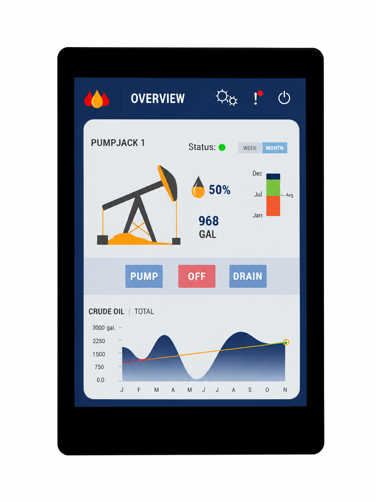
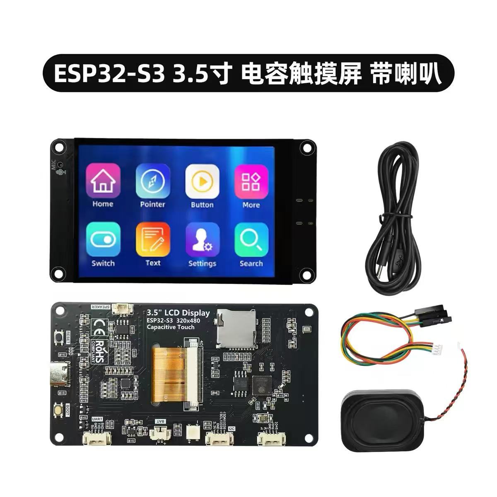

# xTouch-CN

**Test branch `1.0.1-test`**: see the [test board catalog](README.test.md) for additional boards, firmware options and validation status. The guide below describes the four existing release boards.

[简体中文](README.md) | English

An independent touchscreen controller for Bambu Lab printers. Monitor printing, AMS and environmental readings; control temperature, fans and movement; manage printers and cloud accounts in a browser. Not affiliated with Bambu Lab.

Native ESP-IDF 6.1 and LVGL 9.6.0. Match the complete board model and use documentation for your firmware version.

[Installation](docs/INSTALLATION.en.md) · [Web installer](https://tbc0309.github.io/xTouch-CN/) · [Downloads](https://github.com/tbc0309/xTouch-CN/releases/latest) · [Documentation](docs/README.en.md)

## Features

- Eight languages: Simplified Chinese, Traditional Chinese, English, French, German, Russian, Japanese and Korean.
- Monitor printer status, progress, temperatures, fans, Wi-Fi and task previews.
- Manage LAN printers and cloud accounts using Token, password or verification-code login.
- Pause, resume and cancel printing; control temperature, fans, lighting and movement.
- View AMS and external filament sources, material colors, remaining filament and supported loading or drying controls.
- Bind BLE thermometers and choose hidden, alternating or thermometer-only readings.
- View supported local cameras, error codes and printer notifications.
- Configure Wi-Fi and device settings in the browser; back up, restore and update firmware.
- Adjust language, brightness, sounds and standby settings.

## Interface

Six P4 screenshots rendered with demonstration data. The camera image is illustrative; these are not evidence that every printer or peripheral has been tested.

| | |
|---|---|
| **Home**  | **Printing**  |
| **Printer selection**  | **Temperature and fans**  |
| **Filament**  | **Camera**  |

[Full screenshot gallery](docs/SCREENSHOTS.en.md)

## Boards

Hardware specifications are separate from the feature matrix. Similar appearance, chip or screen size does not make firmware interchangeable.

> **More boards (test firmware)**: [Board specifications and validation status](https://github.com/tbc0309/xTouch-CN/blob/test/README.test.md). Test firmware is provided as a pre-release. Check the exact model and validation status, and back up your settings before installing.

| Parameter | CYD | S3 2.8 V2 | P4 4.3 | ES3C35P 3.5 |
|---|---|---|---|---|
| Model | [ESP32-2432S028R (CYD)](docs/HARDWARE.en.md#cyd) | [Waveshare ESP32-S3-Touch-LCD-2.8 V2](docs/HARDWARE.en.md#waveshare) | [Waveshare ESP32-P4-WIFI6-Touch-LCD-4.3](docs/HARDWARE.en.md#waveshare) | [LCDWIKI ES3C35P](boards/lcdwiki-es3c35p/README.en.md) |
| Image |  |  |  |  |
| Display and touch | 320×240; ILI9341 / XPT2046 resistive | 320×240; ST7789 / CST3530 | 800×480; ST7701 / GT911 | 480×320; integrated ST77922 display/touch, 3.5-inch |
| Chip and memory | ESP32; 4 MB Flash, no PSRAM | ESP32-S3; 16 MB Flash, 8 MB PSRAM | P4 v3.x + C6; 32 MB Flash, 32 MB PSRAM | ESP32-S3; 16 MB Flash, 8 MB PSRAM; ES8311 audio, RGB LED |
| Default assets | Small original; ZH/EN, dual OTA | Small original | Large MDI | Large MDI; S3 modules |

Resource size and icon style are independent build options. See the board guide for hardware details and the download manifest for firmware files. [Pins, power and enclosures](docs/HARDWARE.en.md) · [Printer and AMS compatibility](docs/PRINTERS.en.md)

### Feature availability by board

✅ Supported; ❌ unavailable in standard builds; ➖ not applicable. S3 means Waveshare 2.8 V2; 3.5-inch means the LCDWIKI ES3C35P. Printer capabilities, accessories and firmware permissions still apply.

| Feature | CYD | S3 | P4 | 3.5-inch | Notes |
|---|:---:|:---:|:---:|:---:|---|
| Saved devices / accounts | 20 / 10 | 100 / 50 | 100 / 50 | 100 / 50 | Also subject to free memory and credential length |
| LAN printers | ✅ | ✅ | ✅ | ✅ | Validate IP, serial number and access code before saving |
| Access Token | ✅ | ✅ | ✅ | ✅ | China / international accounts; independent login module |
| Password / verification-code login | ✅ | ✅ | ✅ | ✅ | SMS or email verification as requested by the service |
| Multiple saved printers | ✅ | ✅ | ✅ | ✅ | One active connection; isolated data sources |
| Print monitoring, pause / resume / cancel | ✅ | ✅ | ✅ | ✅ | Yellow preparation progress, green printing progress |
| Temperature, fan and motion controls | ✅ | ✅ | ✅ | ✅ | Some commands require LAN and developer modes |
| AMS / external filament | ✅ | ✅ | ✅ | ✅ | Slots, colors, material and reported remaining amount; supported load/unload operations |
| BLE thermometers | ✅ | ✅ | ✅ | ✅ | [Supported devices](docs/THERMOMETERS.en.md); Hide / Alternate / Sensor only |
| Cloud / LAN task thumbnails | ❌ | ✅ | ✅ | ✅ | CYD storage and RAM limits; green Bambu Logo replaces model artwork |
| Local JPEG camera | ❌ | ✅ | ✅ | ✅ | Model/protocol restrictions; camera alone may associate a cloud printer with the same local serial |
| Picture printer picker | ❌ | ✅ | ✅ | ✅ | CYD list only; other boards offer picture/list modes |
| Error codes and essential hints | ✅ | ✅ | ✅ | ✅ | Reported HMS and print errors |
| Full English error details | ❌ | ✅ | ✅ | ✅ | CYD retains codes and essential hints within its capacity |
| Screen and browser languages | ✅ | ✅ | ✅ | ✅ | CYD ZH/EN; eight screen languages on other boards; independent browser language |
| Wi-Fi QR setup / web management | ✅ | ✅ | ✅ | ✅ | Configuration, backups and application OTA |
| Online standby, brightness and sounds | ✅ | ✅ | ✅ | ✅ | Touch wake in online standby; optional sounds |
| RGB status LED | ✅ | ➖ | ➖ | ✅ | CYD / ES3C35P onboard RGB: green online, blinking blue offline, alternating green/yellow on alerts; off when disabled or the screen sleeps |
| Bluetooth Wi-Fi provisioning | ❌ | ❌ | ❌ | ❌ | Off in standard builds; see [build options](docs/DEVELOPMENT.en.md#options) |

## 3D-printable enclosures

[S3 and P4 enclosure models](cases/README.en.md) include buttons, connector-opening and speaker variants. Match the complete board model and extract the STL files. No CYD or ES3C35P model is included.

## Getting started

1. Match the complete board model. Use the application image for updates and `-full.bin` for full USB installation.
2. Calibrate CYD on first boot. Scan the Wi-Fi setup code, join the device hotspot and configure a 2.4 GHz network.
3. Open web management from screen settings, sign in with the initial password `12345678`, then change it.
4. Add and validate a LAN printer, or sign in to a cloud account and select its linked printers.

See [installation](docs/INSTALLATION.en.md) for Token retrieval, backups and recovery.

## Limits

Printer models, accessories and firmware determine capabilities and permissions. Successful login does not authorize every command. Some operations require LAN and developer modes. Cloud status and task images never borrow data from saved LAN printers.

Online standby supports touch wake. Deep-sleep wake depends on hardware; ES3C35P uses BOOT. Backups contain credentials: keep them private. Web management is intended for a trusted LAN. [Usage](docs/USER-GUIDE.en.md) · [Maintenance and security](docs/MAINTENANCE.en.md) · [Error lookup](https://tbc0309.github.io/xTouch-CN/errors.html)

## Development and license

All four targets use native ESP-IDF. Cloud HTTP and thumbnails use `esp_http_client`; MQTT uses `esp_mqtt_client`, without Arduino. See the [development guide](docs/DEVELOPMENT.en.md) for shared UI, module options, builds and asset generation.

Upstream copyright is retained. See the [license](LICENSE.md) and [third-party notices](LICENSE-3RD-PARTY.md).
