# xTouch-CN · 1.0.1-test

Pre-release · 测试版

拓竹打印机的独立触摸控制屏。测试版增加更多主板与屏幕组合，使用原生 ESP-IDF 与 LVGL，提供打印监测、设备控制和网页管理。非拓竹官方产品。

[在线安装](https://tbc0309.github.io/xTouch-CN/) · [安装指南](docs/INSTALLATION.md) · [使用指南](docs/USER-GUIDE.md) · [提交反馈](https://github.com/tbc0309/xTouch-CN/issues/new)

## 功能

- 查看打印进度、温度、风扇、AMS、耗材余量和支持的任务缩略图。
- 管理局域网打印机、云端 Token 账号，使用密码或验证码登录。
- 控制暂停、恢复、取消、灯光、温度、风扇和移动，执行打印机支持的耗材操作。
- 查看兼容摄像头、故障码和权限提示，绑定温湿度计。
- 通过网页配置网络、管理设备、备份恢复设置和更新固件。
- 提供多语言、亮度、提示音与待机设置；功能受主板硬件、可用内存及打印机权限限制。

## 选择与安装

在在线安装页面右上角勾选“测试版”，再选择完整主板型号。测试版安装卡片以红色闪动边框标识；不勾选时安装正式版。安装前请备份配置。

屏幕控制器、触摸芯片、Flash、PSRAM 和主控修订必须匹配。相同芯片或相似外观不代表固件通用。明确配置触摸屏的主板组合也列在下表，屏幕可能需要另购。

## 主板与实测状态

✅ 测试OK；❌ 有问题；➖ 未实测。状态表示本项目在对应硬件上的实物测试结论，与编译结果分开记录。欢迎反馈完整型号、屏幕组合、固件版本和操作结果，核对后更新状态。

“测试固件可用”表示已完成原生编译及镜像检查，不代表所有硬件功能均已通过实物测试。“编译验证中”或“参数待确认”的型号暂不提供安装选项。未映射的 SD、状态灯或独立深睡唤醒功能不启用；普通待机与深睡为不同功能。经典 ESP32、C5 和 S31 的摄像头仅提供兼容 JPEG，不提供 H.264。C6 不编译摄像头和任务缩略图；S31 暂需使用原生 esptool 安装。

固件名下列出资源档位、图标、语言及可选模块配置。“开／关”表示是否编入该功能，不表示实物测试结果；“温湿计”为温湿度计接收模块，“账号登录”为密码／验证码登录，Token 与 Wi-Fi 等公共功能不重复列出。待最终构建确认的配置以实际生成的固件为准。

### ESP32

| 主板 / 品牌 | 主控 | 屏幕 | Flash / PSRAM | 触摸 / 声音 / 状态灯 | 固件 | 用户实测 |
|---|---|---|---|---|---|---|
| 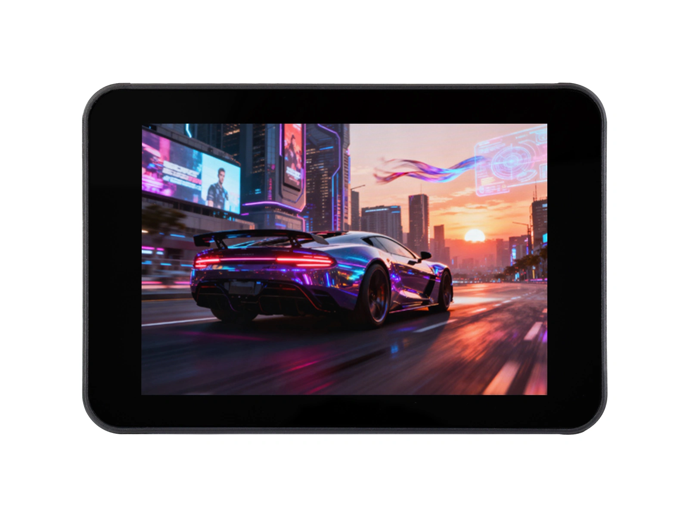 **esp32-touch-lcd-3.5** 微雪电子 / Waveshare | ESP32-D0WDR2-V3 | 3.5″ 320 × 480 ST7796 / SPI | Flash 16 MB PSRAM 2 MB | FT6336 / I²C ES8311，外接扬声器接口 电源/充电指示灯；RGB未证实（待确认） | 测试固件可用 <code>waveshare-esp32-35</code> <small class="firmware-options">大资源 · MDI · 8语 温湿计开 · 账号登录开 状态灯关 · 深睡关 SD关 · 蓝牙配网关 视频仅JPEG</small> | ➖ 未实测 尚无该型号的实物反馈 |

### ESP32-P4

| 主板 / 品牌 | 主控 | 屏幕 | Flash / PSRAM | 触摸 / 声音 / 状态灯 | 固件 | 用户实测 |
|---|---|---|---|---|---|---|
| 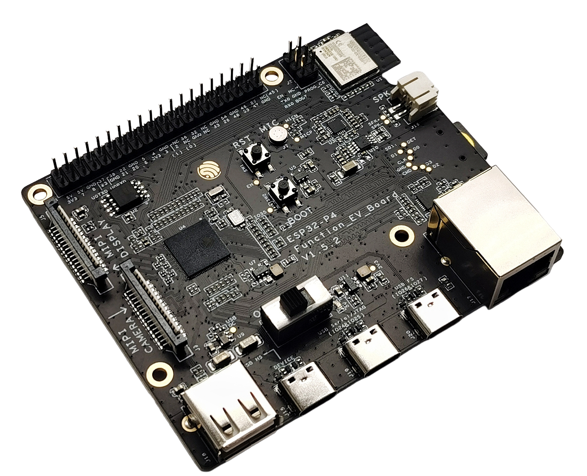 **esp32-p4-function-ev-board** 乐鑫 / Espressif | ESP32-P4 + ESP32-C6-MINI-1 / v1.x | 7″ 1024 × 600 EK79007 / MIPI DSI | Flash 16 MB PSRAM 32 MB | GT911（LCD配件） ES8311 + NS4150B；外接4Ω/3W扬声器 5V电源指示灯；非RGB | 测试固件可用 <code>esp32-p4-function-ev-board</code> <small class="firmware-options">大资源 · MDI · 8语 温湿计开 · 账号登录开 状态灯关 · 深睡开 SD关 · 蓝牙配网关</small> | ➖ 未实测 尚无该型号的实物反馈 |
|  **esp32-p4-nano-10.1-a** 微雪电子 / Waveshare | ESP32-P4 + ESP32-C6 / v1.x | 10.1″ 800 × 1280 MIPI DSI | Flash 16 MB PSRAM 32 MB | GT911 / I²C Codec与功放；外接扬声器接口 待确认 | 测试固件可用 <code>esp32-p4-nano-10.1-a</code> <small class="firmware-options">大资源 · MDI · 8语 温湿计开 · 账号登录开 状态灯关 · 深睡关 SD关 · 蓝牙配网关</small> | ➖ 未实测 尚无该型号的实物反馈 |
| 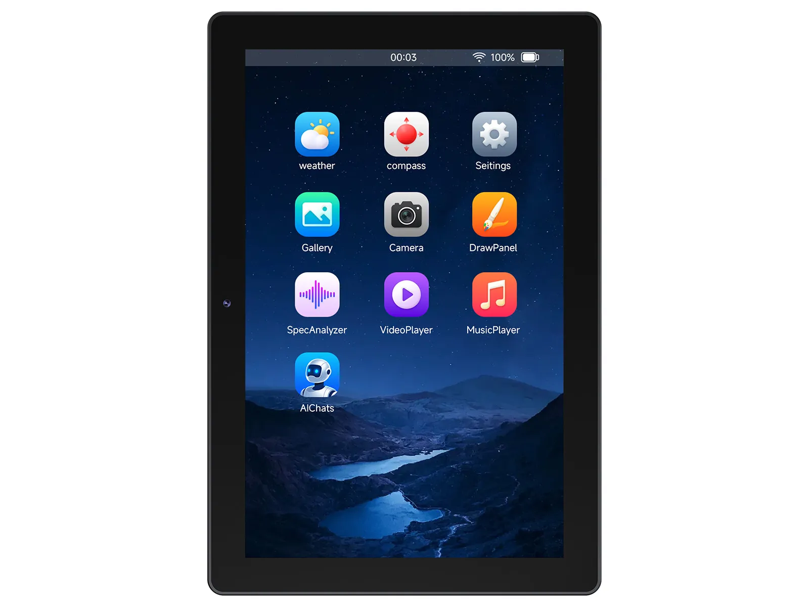 **esp32-p4-wifi6-touch-lcd-10.1** 微雪电子 / Waveshare | ESP32-P4 + ESP32-C6 / v1.x | 10.1″ 800 × 1280 MIPI DSI | Flash 32 MB PSRAM 32 MB | 电容触摸；控制器按屏幕型号核实 ES8311；扬声器接口 电源/充电指示灯；软件状态灯需按原理图区分 | 测试固件可用 <code>esp32-p4-wifi6-touch-lcd-10.1</code> <small class="firmware-options">大资源 · MDI · 8语 温湿计开 · 账号登录开 状态灯关 · 深睡关 SD关 · 蓝牙配网关</small> | ➖ 未实测 尚无该型号的实物反馈 |
| 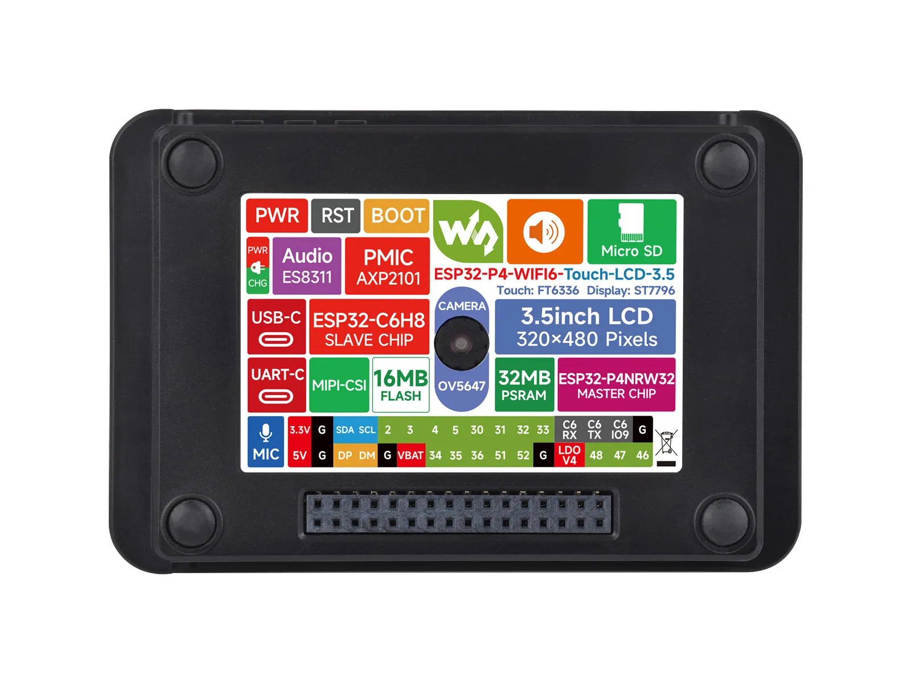 **esp32-p4-wifi6-touch-lcd-3.5** 微雪电子 / Waveshare | ESP32-P4 + ESP32-C6 / v1.x | 3.5″ 320 × 480 ST7796 / SPI | Flash 16 MB PSRAM 32 MB | FT6336 / I²C ES8311；扬声器接口 电源/充电指示灯；软件状态灯需按原理图区分 | 测试固件可用 <code>esp32-p4-wifi6-touch-lcd-3.5</code> <small class="firmware-options">大资源 · MDI · 8语 温湿计开 · 账号登录开 状态灯关 · 深睡关 SD关 · 蓝牙配网关</small> | ➖ 未实测 尚无该型号的实物反馈 |
|  **esp32-p4-wifi6-touch-lcd-5** 微雪电子 / Waveshare | ESP32-P4 + ESP32-C6 / v1.x | 5.0″ 720 × 1280 MIPI DSI | Flash 32 MB PSRAM 32 MB | 电容触摸；控制器按屏幕型号核实 ES8311；扬声器接口 电源/充电指示灯；软件状态灯需按原理图区分 | 测试固件可用 <code>esp32-p4-wifi6-touch-lcd-5</code> <small class="firmware-options">大资源 · MDI · 8语 温湿计开 · 账号登录开 状态灯关 · 深睡关 SD关 · 蓝牙配网关</small> | ➖ 未实测 尚无该型号的实物反馈 |
| 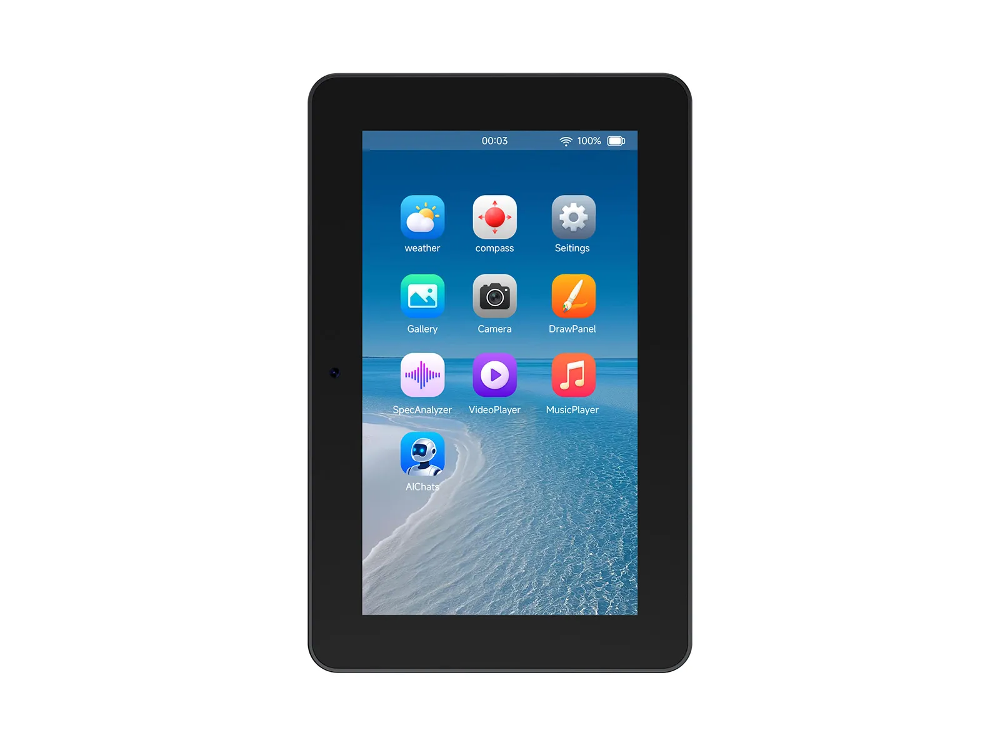 **esp32-p4-wifi6-touch-lcd-7** 微雪电子 / Waveshare | ESP32-P4 + ESP32-C6 / v1.x | 7.0″ 720 × 1280 MIPI DSI | Flash 32 MB PSRAM 32 MB | 电容触摸；控制器按屏幕型号核实 ES8311；扬声器接口 电源/充电指示灯；软件状态灯需按原理图区分 | 测试固件可用 <code>esp32-p4-wifi6-touch-lcd-7</code> <small class="firmware-options">大资源 · MDI · 8语 温湿计开 · 账号登录开 状态灯关 · 深睡关 SD关 · 蓝牙配网关</small> | ➖ 未实测 尚无该型号的实物反馈 |
|  **esp32-p4-wifi6-touch-lcd-7b** 微雪电子 / Waveshare | ESP32-P4 + ESP32-C6 / v1.x | 7.0″ 1024 × 600 MIPI DSI | Flash 32 MB PSRAM 32 MB | 电容触摸；控制器按屏幕型号核实 ES8311；扬声器接口 电源/充电指示灯；软件状态灯需按原理图区分 | 测试固件可用 <code>esp32-p4-wifi6-touch-lcd-7b</code> <small class="firmware-options">大资源 · MDI · 8语 温湿计开 · 账号登录开 状态灯关 · 深睡关 SD关 · 蓝牙配网关</small> | ➖ 未实测 尚无该型号的实物反馈 |
|  **esp32-p4-wifi6-touch-lcd-8** 微雪电子 / Waveshare | ESP32-P4 + ESP32-C6 / v1.x | 8.0″ 800 × 1280 MIPI DSI | Flash 32 MB PSRAM 32 MB | 电容触摸；控制器按屏幕型号核实 ES8311；扬声器接口 电源/充电指示灯；软件状态灯需按原理图区分 | 测试固件可用 <code>esp32-p4-wifi6-touch-lcd-8</code> <small class="firmware-options">大资源 · MDI · 8语 温湿计开 · 账号登录开 状态灯关 · 深睡关 SD关 · 蓝牙配网关</small> | ➖ 未实测 尚无该型号的实物反馈 |
|  **esp32-p4x-function-ev-board** 乐鑫 / Espressif | ESP32-P4 + ESP32-C6-MINI-1 / v3.x | 7″ 1024 × 600 EK79007 / MIPI DSI | Flash 16 MB PSRAM 32 MB | GT911（LCD配件） ES8311 + NS4150B；外接4Ω/3W扬声器 5V电源指示灯；非RGB | 测试固件可用 <code>esp32-p4x-function-ev-board</code> <small class="firmware-options">大资源 · MDI · 8语 温湿计开 · 账号登录开 状态灯关 · 深睡开 SD关 · 蓝牙配网关</small> | ➖ 未实测 尚无该型号的实物反馈 |
| 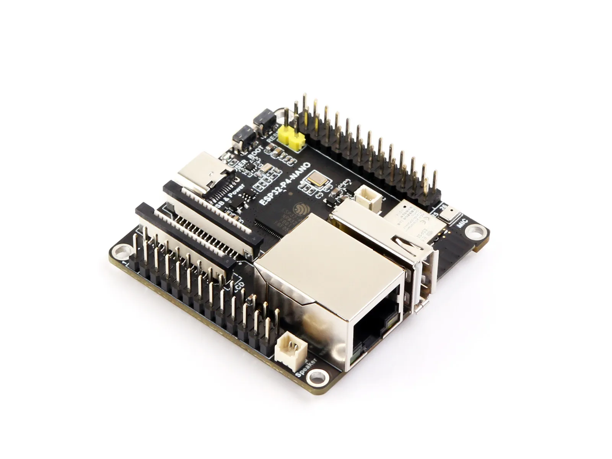 **esp32-p4x-nano-10.1-a** 微雪电子 / Waveshare | ESP32-P4 + ESP32-C6 / v3.x | 10.1″ 800 × 1280 MIPI DSI | Flash 16 MB PSRAM 32 MB | GT911 / I²C Codec与功放；外接扬声器接口 待确认 | 测试固件可用 <code>esp32-p4x-nano-10.1-a</code> <small class="firmware-options">大资源 · MDI · 8语 温湿计开 · 账号登录开 状态灯关 · 深睡关 SD关 · 蓝牙配网关</small> | ➖ 未实测 尚无该型号的实物反馈 |
|  **esp32-p4x-wifi6-touch-lcd-10.1** 微雪电子 / Waveshare | ESP32-P4 + ESP32-C6 / v3.x | 10.1″ 800 × 1280 MIPI DSI | Flash 32 MB PSRAM 32 MB | 电容触摸；控制器按屏幕型号核实 ES8311；扬声器接口 电源/充电指示灯；软件状态灯需按原理图区分 | 测试固件可用 <code>esp32-p4x-wifi6-touch-lcd-10.1</code> <small class="firmware-options">大资源 · MDI · 8语 温湿计开 · 账号登录开 状态灯关 · 深睡关 SD关 · 蓝牙配网关</small> | ➖ 未实测 尚无该型号的实物反馈 |
|  **esp32-p4x-wifi6-touch-lcd-3.5** 微雪电子 / Waveshare | ESP32-P4 + ESP32-C6 / v3.x | 3.5″ 320 × 480 ST7796 / SPI | Flash 16 MB PSRAM 32 MB | FT6336 / I²C ES8311；扬声器接口 电源/充电指示灯；软件状态灯需按原理图区分 | 测试固件可用 <code>esp32-p4x-wifi6-touch-lcd-3.5</code> <small class="firmware-options">大资源 · MDI · 8语 温湿计开 · 账号登录开 状态灯关 · 深睡关 SD关 · 蓝牙配网关</small> | ➖ 未实测 尚无该型号的实物反馈 |
| 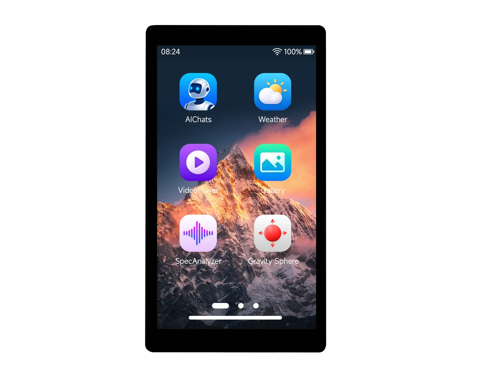 **esp32-p4x-wifi6-touch-lcd-5** 微雪电子 / Waveshare | ESP32-P4 + ESP32-C6 / v3.x | 5.0″ 720 × 1280 MIPI DSI | Flash 32 MB PSRAM 32 MB | 电容触摸；控制器按屏幕型号核实 ES8311；扬声器接口 电源/充电指示灯；软件状态灯需按原理图区分 | 测试固件可用 <code>esp32-p4x-wifi6-touch-lcd-5</code> <small class="firmware-options">大资源 · MDI · 8语 温湿计开 · 账号登录开 状态灯关 · 深睡关 SD关 · 蓝牙配网关</small> | ➖ 未实测 尚无该型号的实物反馈 |
|  **esp32-p4x-wifi6-touch-lcd-7** 微雪电子 / Waveshare | ESP32-P4 + ESP32-C6 / v3.x | 7.0″ 720 × 1280 MIPI DSI | Flash 32 MB PSRAM 32 MB | 电容触摸；控制器按屏幕型号核实 ES8311；扬声器接口 电源/充电指示灯；软件状态灯需按原理图区分 | 测试固件可用 <code>esp32-p4x-wifi6-touch-lcd-7</code> <small class="firmware-options">大资源 · MDI · 8语 温湿计开 · 账号登录开 状态灯关 · 深睡关 SD关 · 蓝牙配网关</small> | ➖ 未实测 尚无该型号的实物反馈 |
| 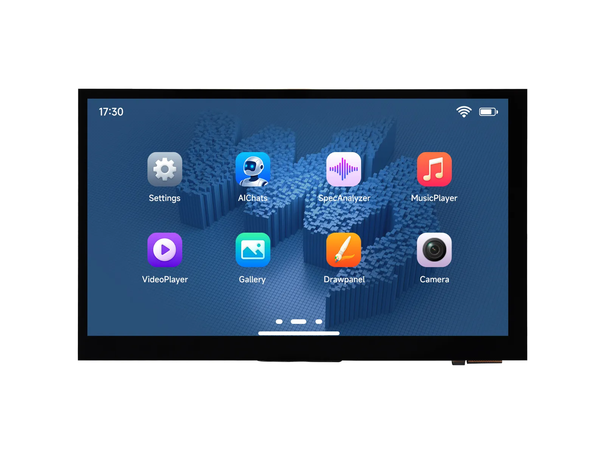 **esp32-p4x-wifi6-touch-lcd-7b** 微雪电子 / Waveshare | ESP32-P4 + ESP32-C6 / v3.x | 7.0″ 1024 × 600 MIPI DSI | Flash 32 MB PSRAM 32 MB | 电容触摸；控制器按屏幕型号核实 ES8311；扬声器接口 电源/充电指示灯；软件状态灯需按原理图区分 | 测试固件可用 <code>esp32-p4x-wifi6-touch-lcd-7b</code> <small class="firmware-options">大资源 · MDI · 8语 温湿计开 · 账号登录开 状态灯关 · 深睡关 SD关 · 蓝牙配网关</small> | ➖ 未实测 尚无该型号的实物反馈 |
| 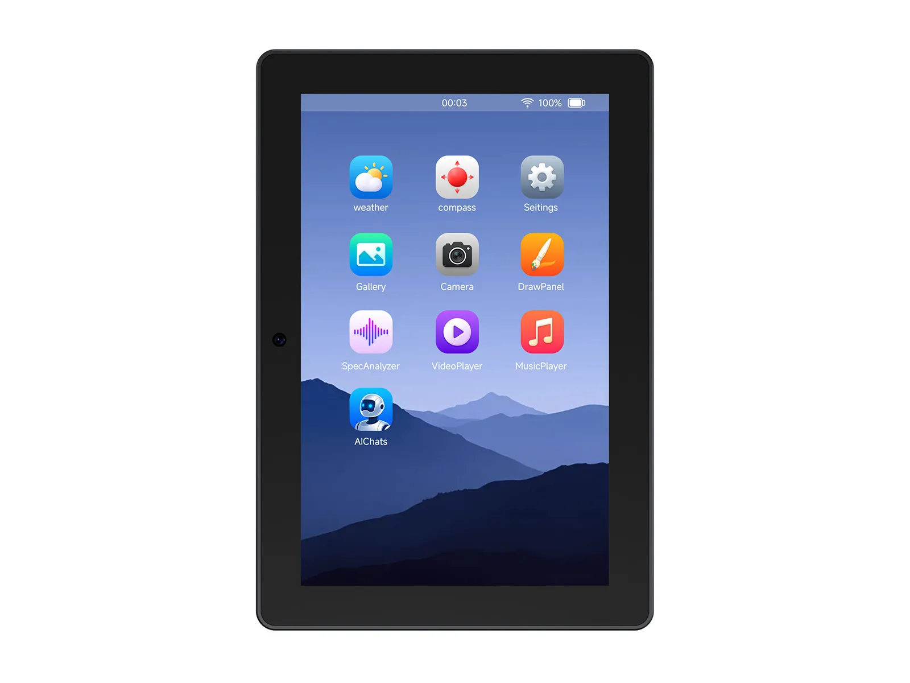 **esp32-p4x-wifi6-touch-lcd-8** 微雪电子 / Waveshare | ESP32-P4 + ESP32-C6 / v3.x | 8.0″ 800 × 1280 MIPI DSI | Flash 32 MB PSRAM 32 MB | 电容触摸；控制器按屏幕型号核实 ES8311；扬声器接口 电源/充电指示灯；软件状态灯需按原理图区分 | 测试固件可用 <code>esp32-p4x-wifi6-touch-lcd-8</code> <small class="firmware-options">大资源 · MDI · 8语 温湿计开 · 账号登录开 状态灯关 · 深睡关 SD关 · 蓝牙配网关</small> | ➖ 未实测 尚无该型号的实物反馈 |
|  **m5stack-tab5-p4x** 未确认官方中文品牌名 / M5Stack | ESP32-P4 + ESP32-C6-MINI-1U | 5″ 720 × 1280 ILI9881C / ST7123 / ST7121；按批次 | Flash 16 MB PSRAM 32 MB | GT911 / ST7123；按批次 ES8388；板载扬声器 未提供可编程RGB状态灯；电源管理指示不计入（待确认） | 测试固件可用 <code>m5stack-tab5-p4x</code> <small class="firmware-options">大资源 · MDI · 8语 温湿计开 · 账号登录开 状态灯关 · 深睡关 SD关 · 蓝牙配网关</small> | ➖ 未实测 尚无该型号的实物反馈 |
| 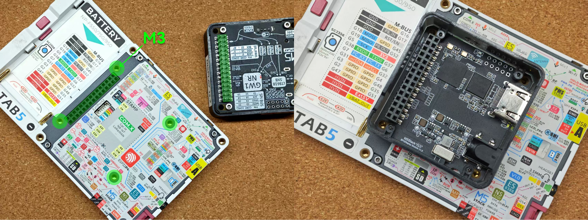 **m5stack-tab5** 未确认官方中文品牌名 / M5Stack | ESP32-P4 + ESP32-C6-MINI-1U | 5″ 720 × 1280 ILI9881C / ST7123 / ST7121；按批次 | Flash 16 MB PSRAM 32 MB | GT911 / ST7123；按批次 ES8388；板载扬声器 未提供可编程RGB状态灯；电源管理指示不计入（待确认） | 测试固件可用 <code>m5stack-tab5</code> <small class="firmware-options">大资源 · MDI · 8语 温湿计开 · 账号登录开 状态灯关 · 深睡关 SD关 · 蓝牙配网关</small> | ➖ 未实测 尚无该型号的实物反馈 |

### ESP32-S3

| 主板 / 品牌 | 主控 | 屏幕 | Flash / PSRAM | 触摸 / 声音 / 状态灯 | 固件 | 用户实测 |
|---|---|---|---|---|---|---|
| 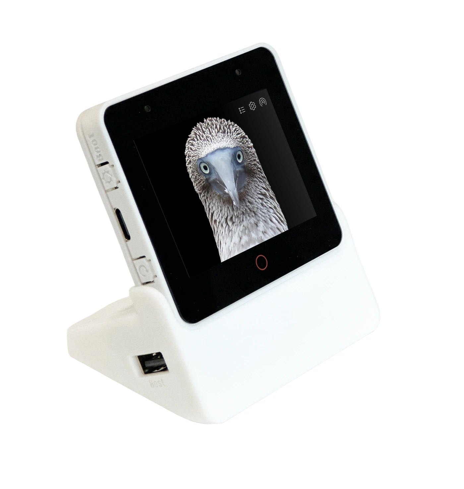 **esp-box-3** 乐鑫 / Espressif | ESP32-S3 | 2.4″ 320 × 240 ST7789 / ILI9342，按BOX-3批次 | Flash 16 MB PSRAM 16 MB | TT21100 / GT911，按BOX-3批次 ES8311；板载扬声器 待确认 | 测试固件可用 <code>esp32-s3-box-3</code> <small class="firmware-options">小资源 · 原装图标 · 8语 温湿计开 · 账号登录开 状态灯关 · 深睡关 SD关 · 蓝牙配网关</small> | ➖ 未实测 尚无该型号的实物反馈 |
| 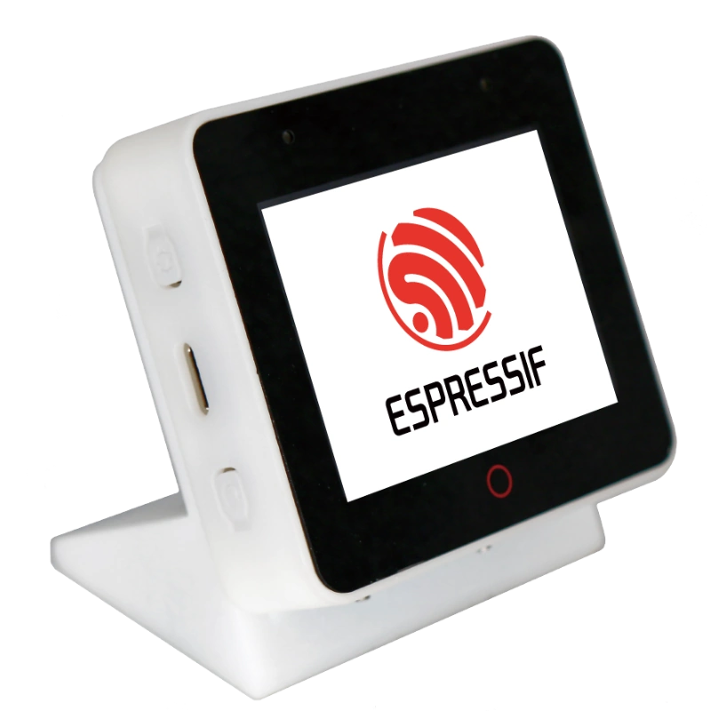 **esp-box** 乐鑫 / Espressif | ESP32-S3 | 2.4″ 320 × 240 ILI9341 / SPI | Flash 16 MB PSRAM 8 MB | TT21100 / I²C ES8311；板载扬声器 待确认 | 测试固件可用 <code>espressif-s3-box</code> <small class="firmware-options">小资源 · 原装图标 · 8语 温湿计开 · 账号登录开 状态灯关 · 深睡关 SD关 · 蓝牙配网关</small> | ➖ 未实测 尚无该型号的实物反馈 |
| 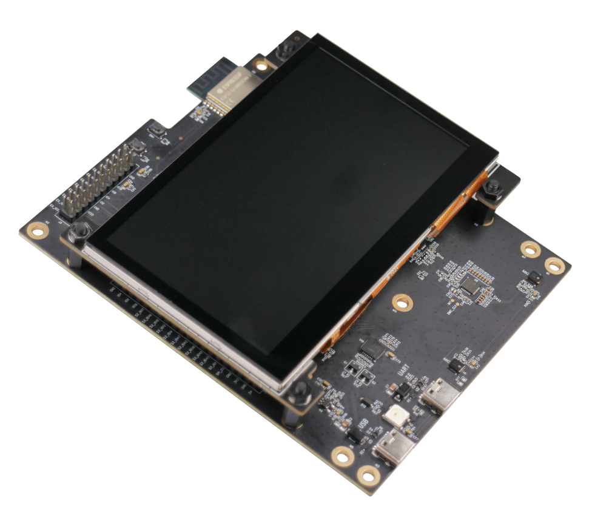 **esp-s3-lcd-ev-board-2** 乐鑫 / Espressif | ESP32-S3-WROOM-1-N16R16V（当前v1.5） | 4.3″ 800 × 480 ST7262E43 / RGB；SUB3 | Flash 16 MB PSRAM 16 MB | GT1151 / I²C ES8311 + NS4150B；外接扬声器 可编程RGB LED | 测试固件可用 <code>espressif-s3-lcd-ev2</code> <small class="firmware-options">大资源 · MDI · 8语 温湿计开 · 账号登录开 状态灯关 · 深睡开 SD关 · 蓝牙配网关</small> | ➖ 未实测 尚无该型号的实物反馈 |
| 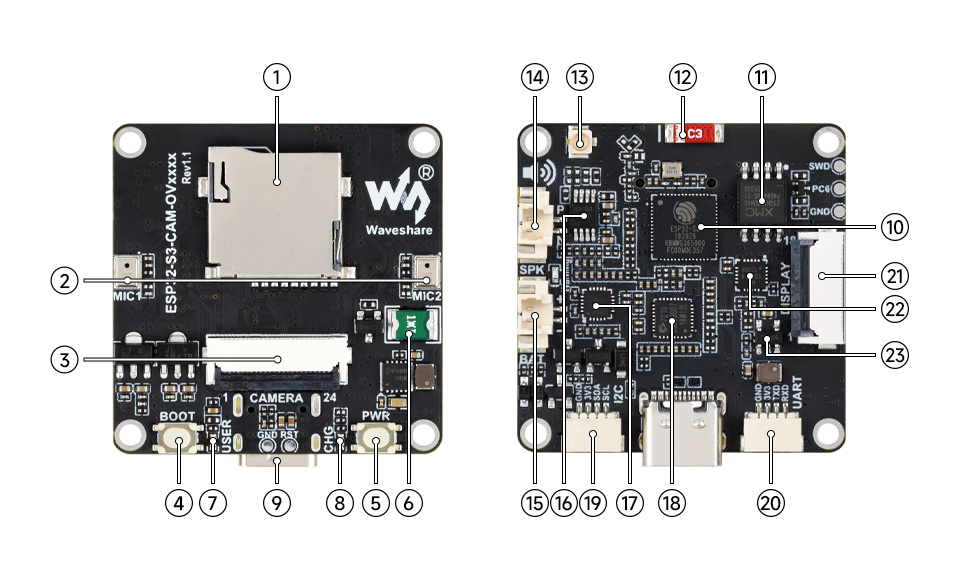 **esp32-s3-cam-2.8** 微雪电子 / Waveshare | ESP32-S3R8 | 2.8″ 240 × 320 ST7789T3 / SPI | Flash 16 MB PSRAM 8 MB | CST328 / I²C ES8311 + NS4150B，外接扬声器；ES7210输入 USER指示灯及充电灯；RGB未证实（待确认） | 测试固件可用 <code>waveshare-cam-28</code> <small class="firmware-options">小资源 · 原装图标 · 8语 温湿计开 · 账号登录开 状态灯关 · 深睡关 SD关 · 蓝牙配网关</small> | ➖ 未实测 尚无该型号的实物反馈 |
|  **esp32-s3-cam-3.5** 微雪电子 / Waveshare | ESP32-S3R8 | 3.5″ 320 × 480 ST7796S / SPI | Flash 16 MB PSRAM 8 MB | FT6336U / I²C ES8311 + NS4150B，外接扬声器；ES7210输入 USER指示灯及充电灯；RGB未证实（待确认） | 测试固件可用 <code>waveshare-cam-35</code> <small class="firmware-options">大资源 · MDI · 8语 温湿计开 · 账号登录开 状态灯关 · 深睡关 SD关 · 蓝牙配网关</small> | ➖ 未实测 尚无该型号的实物反馈 |
| 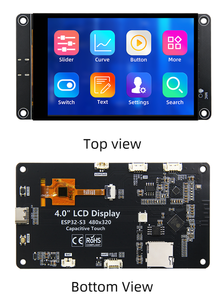 **esp32-s3-spi-4.0** 全动电子 / LCDWIKI / QUANDONG | ESP32-S3 N16R8 | 4″ 320 × 480 ST7796S / SPI | Flash 16 MB PSRAM 8 MB | FT6336U / I²C ES8311，外接扬声器接口、板载麦克风 单线RGB灯 / GPIO42 | 测试固件可用 <code>lcdwiki-es3c40p</code> <small class="firmware-options">大资源 · MDI · 8语 温湿计开 · 账号登录开 状态灯开 · 深睡开 SD关 · 蓝牙配网关</small> | ➖ 未实测 尚无该型号的实物反馈 |
| 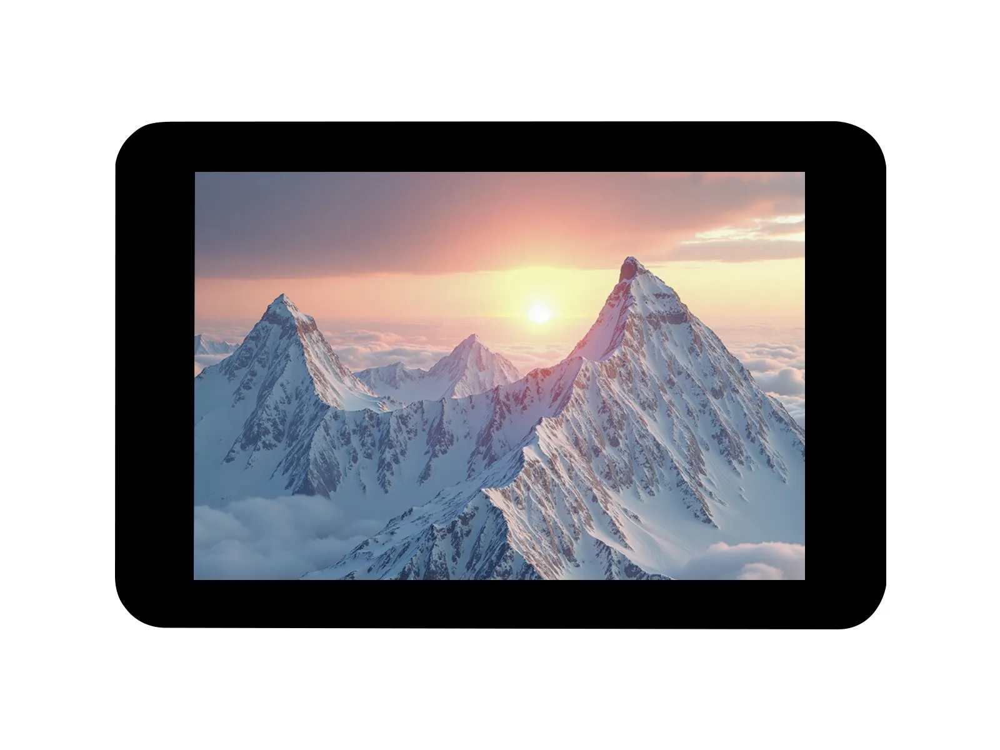 **esp32-s3-touch-lcd-3.5** 微雪电子 / Waveshare | ESP32-S3 | 3.5″ 320 × 480 ST7796 / SPI | Flash 16 MB PSRAM 8 MB | FT6336 / I²C ES8311；扬声器接口 电源与充电指示灯；未确认可编程RGB（待确认） | 测试固件可用 <code>waveshare-s3-35</code> <small class="firmware-options">大资源 · MDI · 8语 温湿计开 · 账号登录开 状态灯关 · 深睡开 SD关 · 蓝牙配网关</small> | ➖ 未实测 尚无该型号的实物反馈 |
| 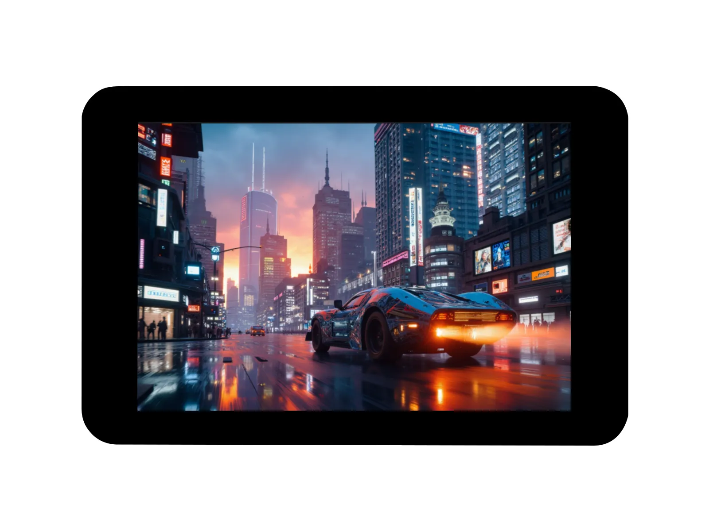 **esp32-s3-touch-lcd-3.5b** 微雪电子 / Waveshare | ESP32-S3 | 3.5″ 320 × 480 AXS15231B / QSPI | Flash 16 MB PSRAM 8 MB | AXS15231B / I²C ES8311；扬声器接口 电源与充电指示灯；未确认可编程RGB（待确认） | 测试固件可用 <code>waveshare-s3-35b</code> <small class="firmware-options">大资源 · MDI · 8语 温湿计开 · 账号登录开 状态灯关 · 深睡开 SD关 · 蓝牙配网关</small> | ➖ 未实测 尚无该型号的实物反馈 |
| 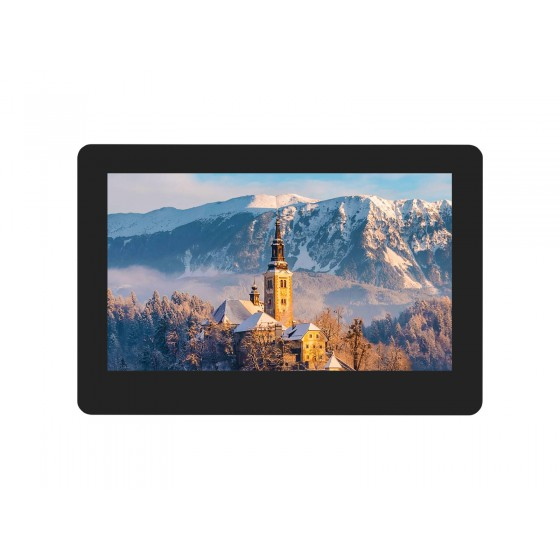 **esp32-s3-touch-lcd-4.3c** 微雪电子 / Waveshare | ESP32-S3 | 4.3″ 800 × 480 RGB；型号另核（待确认） | Flash 16 MB PSRAM 8 MB | GT911 / I²C ES8311 + ES7210；扬声器接口 待确认 | 测试固件可用 <code>waveshare-s3-43c</code> <small class="firmware-options">大资源 · MDI · 8语 温湿计开 · 账号登录开 状态灯关 · 深睡关 SD关 · 蓝牙配网关</small> | ➖ 未实测 尚无该型号的实物反馈 |
| 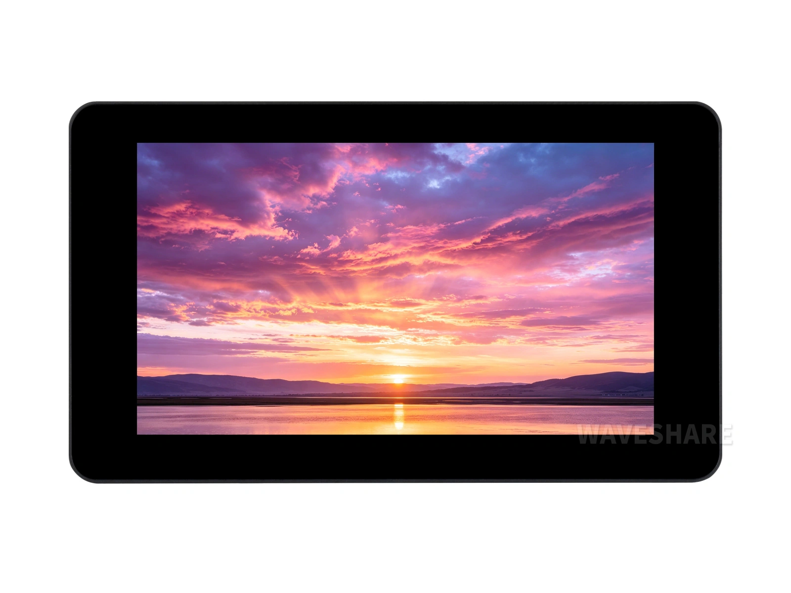 **esp32-s3-touch-lcd-7c** 微雪电子 / Waveshare | ESP32-S3 | 7″ 800 × 480 RGB；型号另核（待确认） | Flash 32 MB PSRAM 16 MB | GT911 / I²C ES8389 + ES7210；扬声器接口 PWR、充电灯及用户可定义STA灯；非RGB | 测试固件可用 <code>waveshare-s3-7c</code> <small class="firmware-options">大资源 · MDI · 8语 温湿计开 · 账号登录开 状态灯关 · 深睡关 SD关 · 蓝牙配网关</small> | ➖ 未实测 尚无该型号的实物反馈 |
| 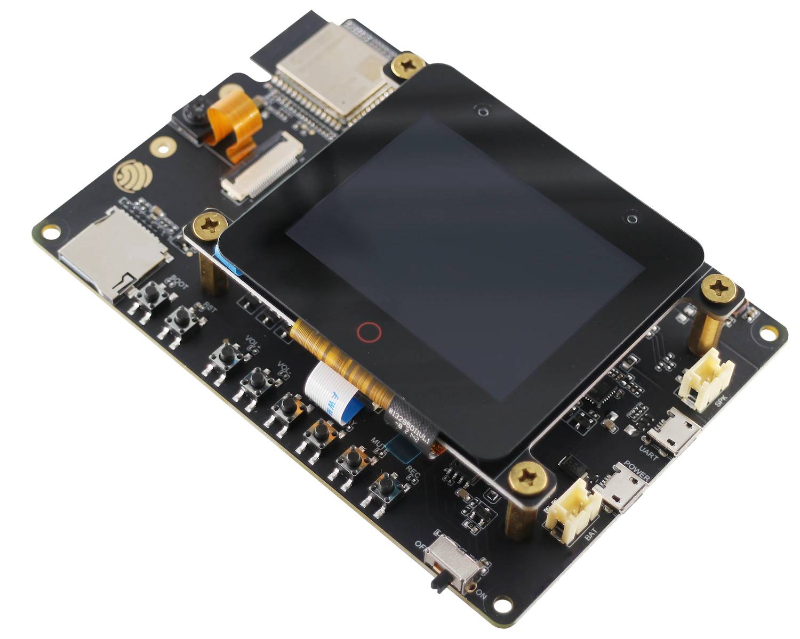 **esp32s3-korvo2-v3-rndis** 乐鑫 / Espressif | ESP32-S3-WROOM-1-N16R8 | 2.4″ 320 × 240 ILI9341 / SPI | Flash 16 MB PSRAM 8 MB | TT21100 / GT911，按LCD批次 ES8311 + NS4150；外接扬声器 红/绿软件控制LED；不是RGB灯 | 测试固件可用 <code>esp32-s3-korvo2-lcd-rndis</code> <small class="firmware-options">小资源 · 原装图标 · 8语 温湿计开 · 账号登录开 状态灯关 · 深睡关 SD关 · 蓝牙配网关</small> | ➖ 未实测 尚无该型号的实物反馈 |
|  **esp32s3-korvo2-v3** 乐鑫 / Espressif | ESP32-S3-WROOM-1-N16R8 | 2.4″ 320 × 240 ILI9341 / SPI | Flash 16 MB PSRAM 8 MB | TT21100 / GT911，按LCD批次 ES8311 + NS4150；外接扬声器 红/绿软件控制LED；不是RGB灯 | 测试固件可用 <code>esp32-s3-korvo2-lcd</code> <small class="firmware-options">小资源 · 原装图标 · 8语 温湿计开 · 账号登录开 状态灯关 · 深睡关 SD关 · 蓝牙配网关</small> | ➖ 未实测 尚无该型号的实物反馈 |
| 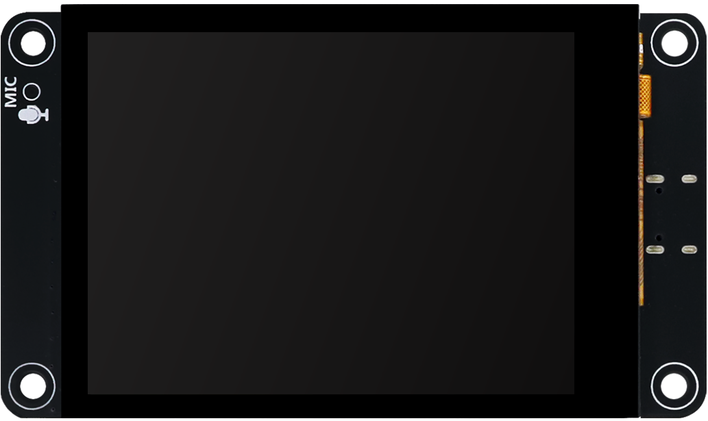 **freenove-esp32s3-display-2.8-lcd** 未确认官方中文名 / Freenove | ESP32-S3 N16R8 | 2.8″ 240 × 320 ILI9341 / SPI | Flash 16 MB PSRAM 8 MB | FNK0104B电容触摸；FNK0104A无触摸 ES8311 + SC8002B，外接扬声器接口 WS2812B RGB / GPIO42 | 测试固件可用 <code>freenove-s3-28</code> <small class="firmware-options">小资源 · 原装图标 · 8语 温湿计开 · 账号登录开 状态灯关 · 深睡开 SD关 · 蓝牙配网关</small> | ➖ 未实测 尚无该型号的实物反馈 |
| 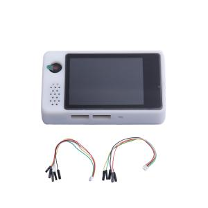 **lichuang-dev** 立创开发板 / LCKFB | ESP32-S3-WROOM-1-N16R8 | 2″ 320 × 240 ST7789 / SPI | Flash 16 MB PSRAM 8 MB | 电容触摸；FT6336/FT5x06见原理图 ES8311输出、ES7210输入；1W扬声器 待确认 | 测试固件可用 <code>lckfb-s3</code> <small class="firmware-options">小资源 · 原装图标 · 8语 温湿计开 · 账号登录开 状态灯关 · 深睡开 SD关 · 蓝牙配网关</small> | ➖ 未实测 尚无该型号的实物反馈 |
| 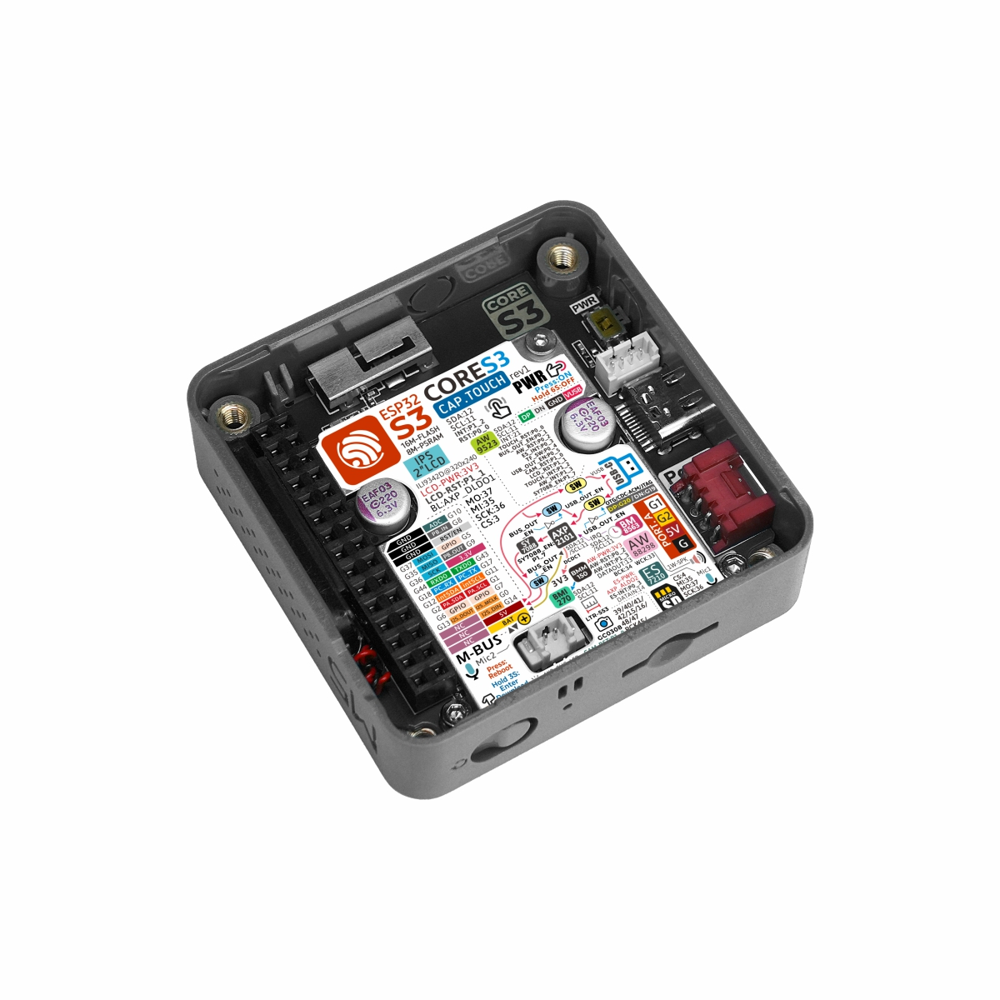 **m5stack-core-s3** 未确认官方中文品牌名 / M5Stack | ESP32-S3 | 2″ 320 × 240 ILI9342C / SPI | Flash 16 MB PSRAM 8 MB | FT6336U电容触摸 / I²C AW88298，板载扬声器；ES7210双麦克风 电源指示灯；无已确认可编程RGB状态灯（待确认） | 测试固件可用 <code>cores3</code> <small class="firmware-options">小资源 · 原装图标 · 8语 温湿计开 · 账号登录开 状态灯关 · 深睡关 SD关 · 蓝牙配网关</small> | ➖ 未实测 尚无该型号的实物反馈 |
| 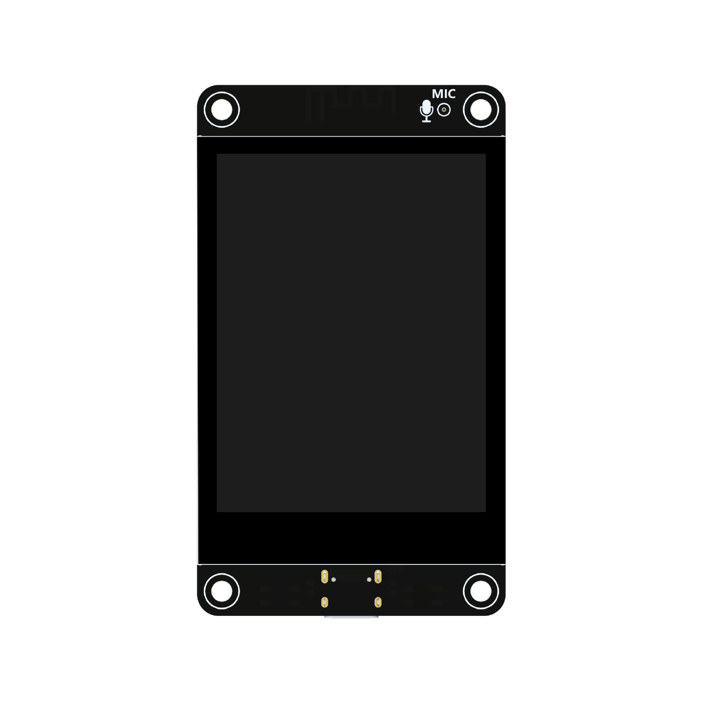 **quandong-s3-dev** 全动电子 / LCDWIKI / QUANDONG | ESP32-S3 N16R8 | 2.8″ 240 × 320 ILI9341V / SPI | Flash 16 MB PSRAM 8 MB | FT6336G / I²C；仅ES3C28P，ES3N28P无触摸 ES8311，外接扬声器接口、板载麦克风 单线RGB灯 / GPIO42 | 测试固件可用 <code>lcdwiki-es3c28p</code> <small class="firmware-options">小资源 · 原装图标 · 8语 温湿计开 · 账号登录开 状态灯开 · 深睡开 SD关 · 蓝牙配网关</small> | ➖ 未实测 尚无该型号的实物反馈 |
| 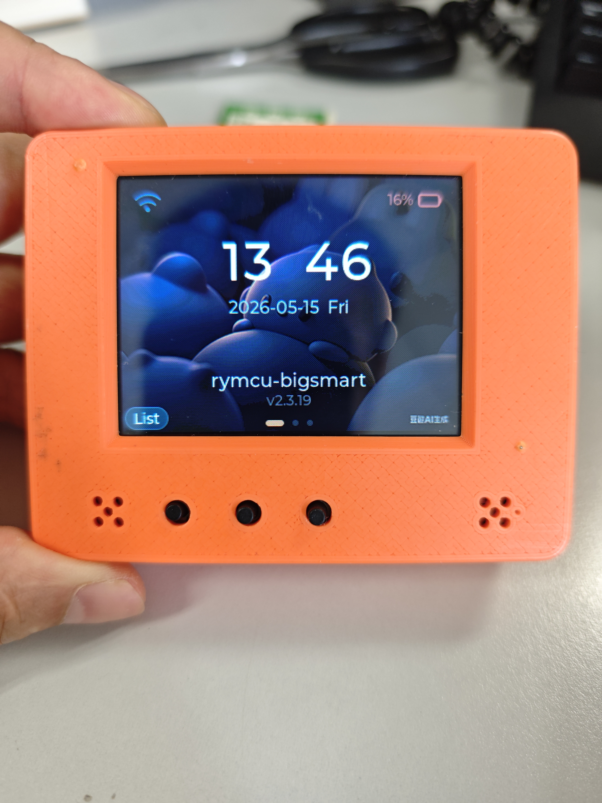 **rymcu-bigsmart** 未确认官方中文品牌名 / RYMCU | ESP32-S3-WROOM-1-N16R8 | 2.8″ 320 × 240 ST7789 / SPI | Flash 16 MB PSRAM 8 MB | GT911 / I²C ES8311 + NS4150B；ES7210输入 WS2812B RGB / GPIO43（与UART0_TX复用） | 测试固件可用 <code>rymcu-s3</code> <small class="firmware-options">小资源 · 原装图标 · 8语 温湿计开 · 账号登录开 状态灯开 · 深睡开 SD关 · 蓝牙配网关</small> | ➖ 未实测 尚无该型号的实物反馈 |
| <small>暂无对应图片</small> **chd-esp32s3-box** 中文品牌未确认 / CHD | ESP32-S3 N16R8 | 2.8″ 240 × 320 ST7789 / SPI | Flash 16 MB PSRAM 8 MB | GT911 / FT6336G，按装配批次 ES8311 + NS4156；ES7210输入 待确认 | 测试固件可用 <code>chd-s3-box28</code> <small class="firmware-options">小资源 · 原装图标 · 8语 温湿计开 · 账号登录开 状态灯关 · 深睡开 SD关 · 蓝牙配网关</small> | ➖ 未实测 尚无该型号的实物反馈 |
| <small>暂无对应图片</small> **chd-esp32s3-box-lcd35** 中文品牌未确认 / CHD | ESP32-S3 N16R8 | 3.5″ 320 × 480 ST7796 / SPI | Flash 16 MB PSRAM 8 MB | GT911 / FT6336G，按装配批次 ES8311 + NS4156；ES7210输入 待确认 | 测试固件可用 <code>chd-s3-box35</code> <small class="firmware-options">大资源 · MDI · 8语 温湿计开 · 账号登录开 状态灯关 · 深睡开 SD关 · 蓝牙配网关</small> | ➖ 未实测 尚无该型号的实物反馈 |
| 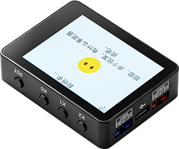 **ATK-DNESP32S3 BOX3** 正点原子 / ALIENTEK | ESP32-S3R8 | 2.4″ 320 × 240 ST7789V2 / SPI | Flash 16 MB PSRAM 8 MB | CHSC5432 / I²C ES8311 + NS4150B 双色灯不作为RGB状态灯 | 测试固件可用 <code>atk-dnesp32s3-box3</code> <small class="firmware-options">小资源 · 原装图标 · 8语 温湿计开 · 账号登录开 状态灯关 · BOOT深睡开 SD关 · 蓝牙配网关 背光仅开关</small> | ➖ 未实测 |
|  **guition-jc4827w543-ext-amp** 未确认官方中文品牌名 / GUITION | ESP32-S3R8 | 4.3″ 480 × 272 规格书ST3401A；厂家组件ST77916；既有驱动NV3041A，尚未消歧（待确认） | Flash 4 MB PSRAM 8 MB | GT911 / XPT2046 / 无，按后缀（待确认） 待确认 待确认 | 容量／面板待解决 <small>模块配置待确定</small> | ➖ 未实测 尚无该型号的实物反馈 |
| 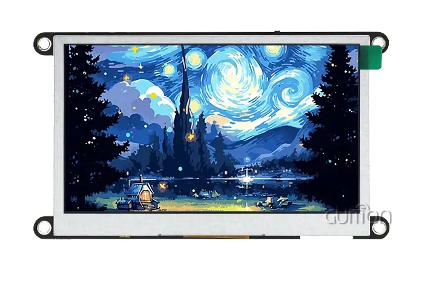 **guition-jc4827w543** 未确认官方中文品牌名 / GUITION | ESP32-S3R8 | 4.3″ 480 × 272 规格书ST3401A；厂家组件ST77916；既有驱动NV3041A，尚未消歧（待确认） | Flash 4 MB PSRAM 8 MB | GT911 / XPT2046 / 无，按后缀（待确认） 待确认 待确认 | 容量／面板待解决 <small>模块配置待确定</small> | ➖ 未实测 尚无该型号的实物反馈 |
| <small>暂无对应图片</small> **yunliao-s3** 云聊（产品名，品牌归属待确认） / Yunliao | ESP32-S3 | 2.8″ 320 × 240 ST7789 / SPI（公开配置） | Flash 待确认 PSRAM 待确认 | 待确认 ES8388；8389仅为作者后续计划 待确认 | 参数待确认 <small>模块配置待确定</small> | ➖ 未实测 尚无该型号的实物反馈 |

### ESP32-C5

| 主板 / 品牌 | 主控 | 屏幕 | Flash / PSRAM | 触摸 / 声音 / 状态灯 | 固件 | 用户实测 |
|---|---|---|---|---|---|---|
| 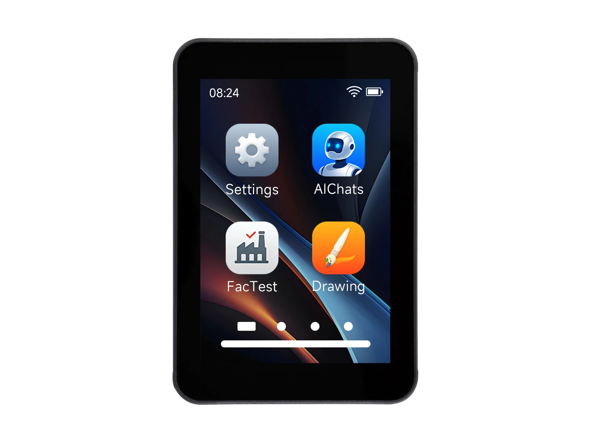 **waveshare-c5-35** 微雪 / Waveshare | ESP32-C5 | 3.5″ 480 × 320 ST7796 / SPI | 32 MB / 8 MB | FT6336 / I²C ES8311 无RGB状态灯 | 测试固件可用 <code>waveshare-c5-35</code> <small class="firmware-options">大资源 · MDI · 8语 温湿计开 · 账号登录开 JPEG摄像头 · 缩略图开 深睡关 · SD关 · 蓝牙配网关</small> | ➖ 未实测 |

### ESP32-C6

| 主板 / 品牌 | 主控 | 屏幕 | Flash / PSRAM | 触摸 / 声音 / 状态灯 | 固件 | 用户实测 |
|---|---|---|---|---|---|---|
|  **waveshare-c6-28** 微雪 / Waveshare | ESP32-C6 | 2.8″ 320 × 240 ST7789 / SPI | 16 MB / 无PSRAM | CST3530 / I²C ES8311 无RGB状态灯 | 测试固件可用 <code>waveshare-c6-28</code> <small class="firmware-options">小资源 · 原装图标 · 8语 温湿计开 · 账号登录开 摄像头关 · 缩略图关 10账号 / 20设备 深睡关 · SD关 · 蓝牙配网关</small> | ➖ 未实测 |

### ESP32-S31

| 主板 / 品牌 | 主控 | 屏幕 | Flash / PSRAM | 触摸 / 声音 / 状态灯 | 固件 | 用户实测 |
|---|---|---|---|---|---|---|
| 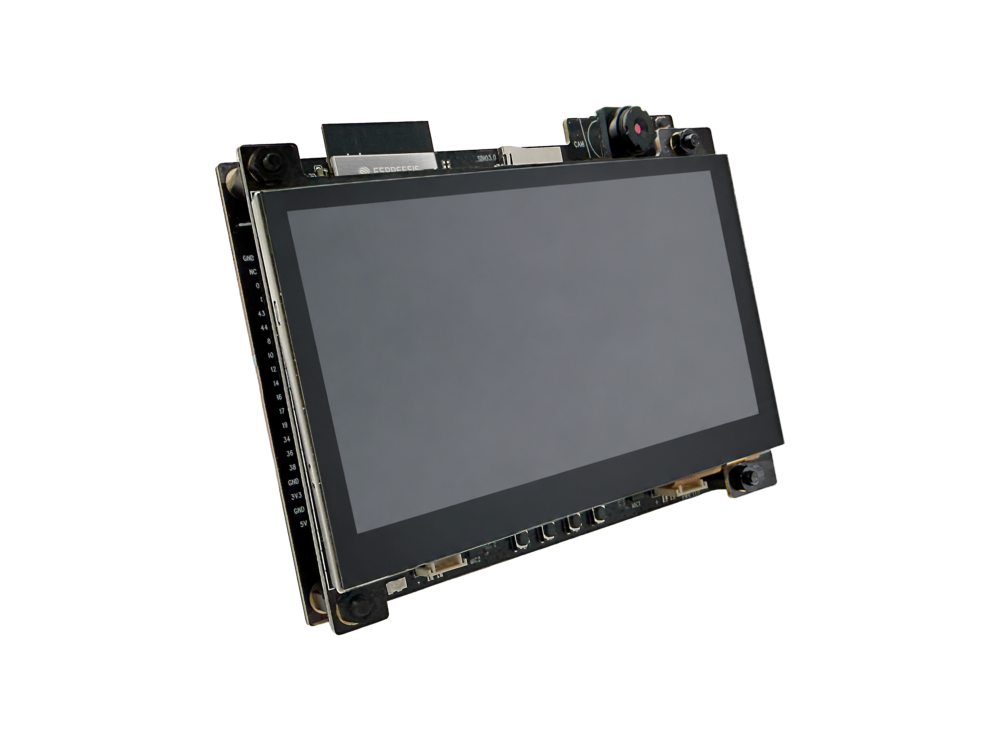 **esp32-s31-korvo-1** 乐鑫 / Espressif | ESP32-S31 | 4.3″ 800 × 480 RGB · SUB3屏幕子板 | 16 MB / 16 MB | GT1151 / I²C ES8389 WS2812 RGB | 需原生esptool安装 <code>esp32-s31-korvo-1</code> <small class="firmware-options">大资源 · MDI · 8语 温湿计开 · 账号登录开 JPEG摄像头 · 缩略图开 状态灯开 · 不支持亮度调节 深睡关 · SD关 · 蓝牙配网关</small> | ➖ 未实测 |

## 使用与反馈

正式支持的 CYD、S3 2.8 V2、P4 4.3 和 ES3C35P 3.5 的安装与硬件说明见[硬件指南](docs/HARDWARE.md)。新增型号的测试固件只列出已完成构建检查的镜像。

反馈问题时请说明：完整主板型号和修订、屏幕及触摸芯片、固件版本、复现步骤，以及显示、触摸、声音、联网、温湿度计和待机的实际表现。请勿在反馈中公开账号、Token、访问码或 Wi-Fi 密码。
