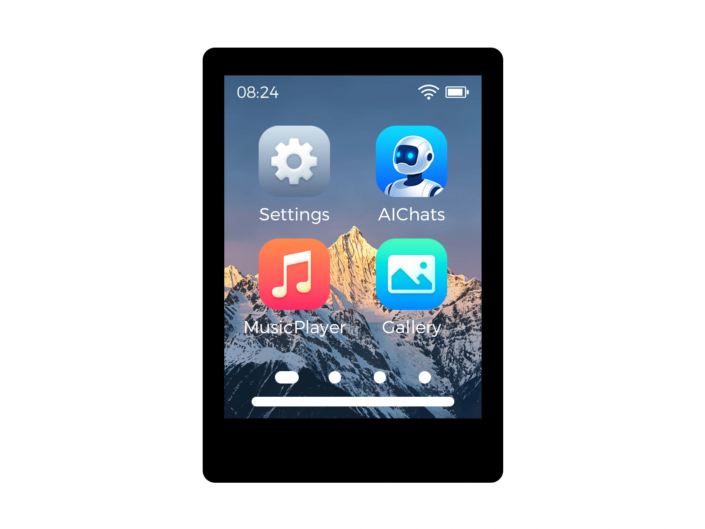

# Waveshare／微雪 ESP32-C6-Touch-LCD-2.8

实物状态：➖ 未实测。适用下列准确主板和屏幕组合，不与其它同尺寸主板混刷。



| 硬件 | 参数 |
| --- | --- |
| 显示 | 2.8英寸，ST7789，320×240（原生240×320） |
| Flash / PSRAM | 16MB / 无PSRAM |
| 触摸 | CST3530；CH32V003复位 |
| 声音 | ES8311，BCLK时钟，无独立MCLK |
| 亮度 | CH32V003 8位PWM |
| 状态灯 | 无应用RGB状态灯 |

固件包含八种屏幕语言、Wi-Fi扫码配网、网页管理、局域网/云端打印机、Token与账号密码/验证码登录、打印监控和机型支持的控制指令。硬件和打印机权限仍决定具体功能是否可用。

| 模块 | 配置 |
| --- | --- |
| 打印机摄像头 | 不编译 |
| 任务缩略图 | 不编译 |
| 温湿度计（Xiaomi BLE） | ✓ |
| 待机 | 常规联网待机，触摸/BOOT唤醒；不包含深睡 |
| SD卡 | 接口暂未映射，不启用SD更新 |
| 蓝牙配网 | 默认不编译 |

低内存配置：最多10个账号、20台设备；列表式设备选择；49,152字节界面内存池。

激活ESP-IDF 6.1环境后，在项目根目录构建：

```sh
python boards/build.py waveshare-c6-28 --allow-candidate-build
```

应用与完整镜像生成于 `boards/build-waveshare-c6-28/artifacts/`。仅在确认主板匹配后使用原生串口工具刷写。测试固件保留独立项目身份及 main/test 双路OTA清单地址；编译结果不替代实物验收。

厂家资料：
- https://docs.waveshare.com/ESP32-C6-Touch-LCD-2.8
