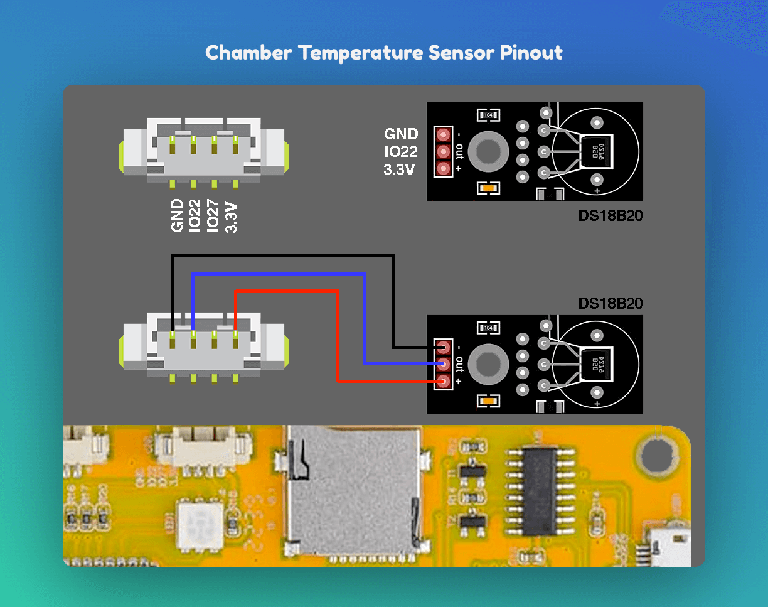

# Boards and peripherals

[简体中文](HARDWARE.md) | English | [Documentation](README.en.md)

Verify the full model, display/touch controllers and GPIO wiring. Similar dimensions or appearance do not make firmware interchangeable; arbitrary panels are not auto-detected.

## CYD · ESP32-2432S028R

Classic ESP32, 4 MB Flash, no PSRAM, ILI9341 display and XPT2046 resistive touch, landscape 320×240. The panel uses native ESP-IDF SPI with the selected ILI9341_2-style initialization profile, with native display and touch drivers. Initial calibration is required.

| Peripheral | Signals | GPIO |
|---|---|---|
| Display | MOSI/SCLK/CS/DC/RST | 13/14/15/2/12 |
| Backlight | PWM | 21 |
| Touch | MOSI/MISO/CLK/CS/IRQ | 32/39/25/33/36 |
| SD | MOSI/MISO/SCLK/CS | 23/19/18/5 |

Display SPI is 40 MHz; touch uses independent sampling pins. See the [board driver](../boards/esp32-2432s028r/display.cpp). Dual OTA is retained with Chinese/English, a list-only picker and single printing artwork. Camera, task thumbnails and full error descriptions are omitted. No reliable battery gauge is configured, so no inferred battery percentage is shown.

## Waveshare S3 V2 and P4

| Board | Adapted hardware |
|---|---|
| ESP32-S3-Touch-LCD-2.8 V2 | ESP32-S3, 16 MB Flash/8 MB PSRAM, ST7789/CST3530, landscape 320×240 |
| ESP32-P4-WIFI6-Touch-LCD-4.3 | P4 v3.x (minimum v3.0) + C6, 32 MB Flash/32 MB PSRAM, ST7701 MIPI/GT911, landscape 800×480 |

S3 V1/CST328, B/C variants and other P4 revisions are not automatically compatible. Neither board uses CYD calibration or its external-sensor wiring. P4 uses the Hosted 3 host.

| Reference | Location |
|---|---|
| S3 | [Driver/configuration](../boards/esp32-s3-touch-lcd-2.8-v2/README.en.md) |
| P4 | [Driver/configuration](../boards/esp32-p4-wifi6-touch-lcd-4.3/README.en.md) |
| Shared interface | [board.h](../boards/common/board.h) |

### Cases

[S3 cases](../cases/case_esp32-s3-touch-lcd-2.8-v2.zip) offer thickness, USB/TF-opening and speaker options. [P4 cases](../cases/case_esp32-p4-wifi6-touch-lcd-4.3.zip) include 40-pin and speaker variants. Select for the exact board and connectors.

## External chamber temperature

CYD's independent [external chamber module](../src/features/external_chamber/sensor.h) uses native OneWire for a DS18B20 on GPIO22 and is excluded by default. Select it for a custom build with `python boards/build.py cyd --external-chamber`. This wired adapter is separate from BLE thermometers and adds no chamber heating capability. The standard firmware's Thermometer setting controls the display mode of the BLE sensor bound in web management. Printer-reported chamber temperature remains available independently of this optional adapter.

## Additional boards

Resolution, resource size, icon style and feature capabilities are separate configuration choices. New ports require vendor schematics, panel initialization, touch mapping, audio, power and boot-pin checks, followed by builds, simulation and hardware validation. Do not list unfinished ports as release-supported boards. See [development rules](DEVELOPMENT.en.md).

## LCDWIKI ES3C35P

ESP32-S3, 3.5-inch ST77922, 16 MB Flash / 8 MB PSRAM, 480×320 with large resources and the same optional modules as the existing S3. See the [board notes](../boards/lcdwiki-es3c35p/README.en.md). Its pins and firmware identity differ from Waveshare S3; use the image for this board.

## Saved-device limits

CYD: up to 20 saved devices and 10 accounts. S3, P4 and ES3C35P: up to 100 devices and 50 accounts. Capacity also depends on available memory and credential length. One printer is active at a time.
