# 32×32 pixel display gallery

[简体中文](PIXEL_DISPLAYS.md) · [English](PIXEL_DISPLAYS.en.md)

The two layouts change the main printing view. Preparation, filament changes and result screens are shared. Progress and remaining time stay visible, while the model grows with the reported layer count.

## Printing layouts

|  |  |
|:---:|:---:|
| **Colour printer** 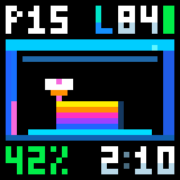 | **Progress view** 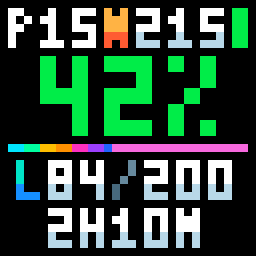 |

Progress view: the completed section flows right in rainbow colours; the remaining section uses the current filament colour.

## Preparation

|  |  |  |
|:---:|:---:|:---:|
| **Preparation: waiting** 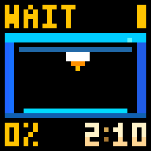 | **Heating** 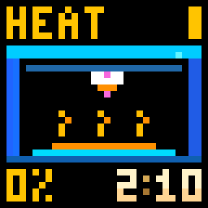 | **Homing** 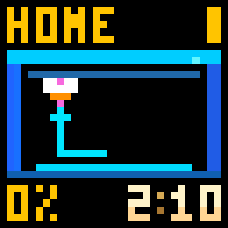 |
| **Bed levelling** 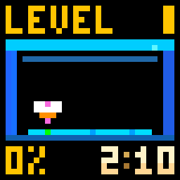 | **Nozzle cleaning** 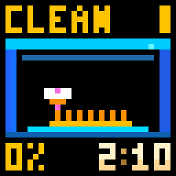 | **Loading / unloading** 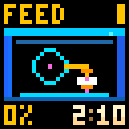 |
| **Calibration** 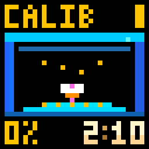 | **Checking** 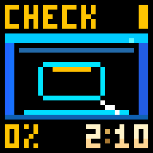 | **Chamber heating** 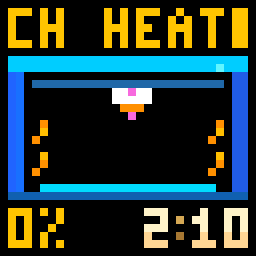 |

## Printing and filament

|  |  |  |
|:---:|:---:|:---:|
| **First layer** 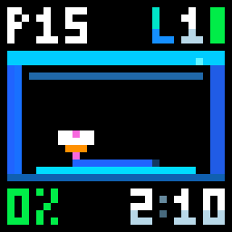 | **Filament change** 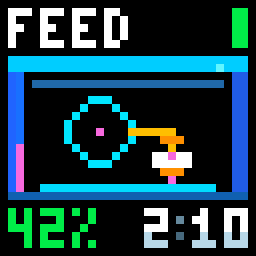 | **Finishing** 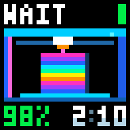 |
| **Final layers** 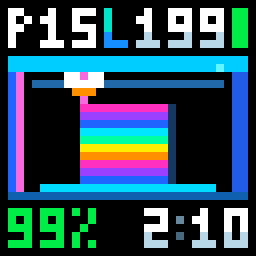 | **Printing with chamber heating** 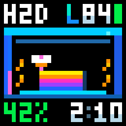 | **Black filament** 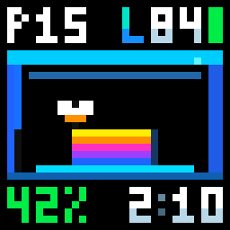 |
| **White filament** 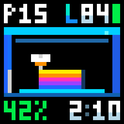 | **Unknown filament colour** 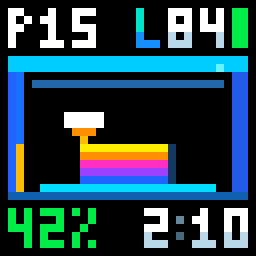 |  |

## Pause and results

|  |  |  |
|:---:|:---:|:---:|
| **Paused** 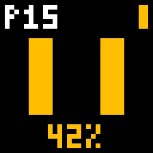 | **Complete** 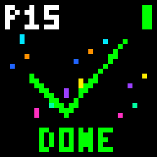 | **Cancelled** 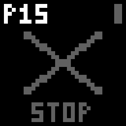 |
| **Error** 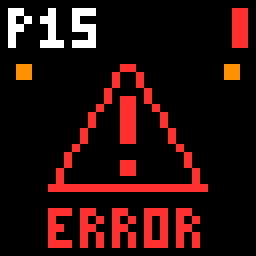 | **Offline** 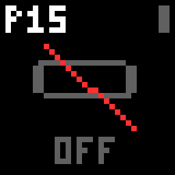 |  |

## Idle

|  |  |  |
|:---:|:---:|:---:|
| **Idle clock preview** 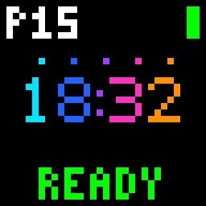 | **Waiting for time sync** 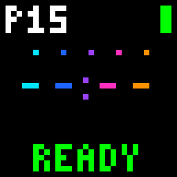 | **Temperature and humidity** 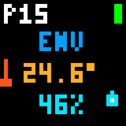 |

## Scrolling values

|  |  |  |
|:---:|:---:|:---:|
| **Long layer counts** 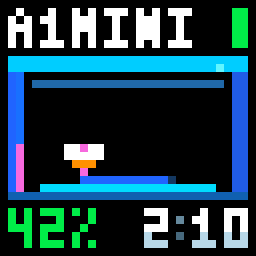 | **Long preparation values**  | **Long remaining time** 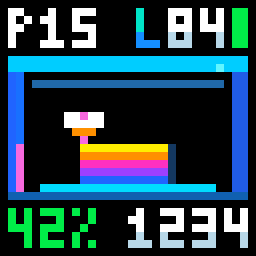 |

Actual idle operation uses the iDotMatrix built-in clock; its font depends on the device. Optional temperature and humidity alternate with the clock every 10 seconds when valid environment readings are available; otherwise only the clock is shown.

[Back to project](../README.en.md)
