# 32×32 像素屏画面

[简体中文](PIXEL_DISPLAYS.md) · [English](PIXEL_DISPLAYS.en.md)

两种布局仅切换打印中的主画面，准备、换料及结果状态共用。底部显示打印进度和剩余时间，模型随层数增长。

## 打印中显示方式

|  |  |
|:---:|:---:|
| **彩色打印机** 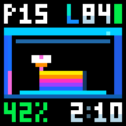 | **进度视图** 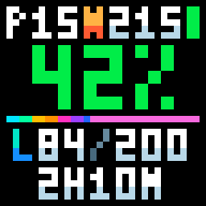 |

进度视图：已完成部分彩色向右流动，未完成部分为当前耗材颜色。

## 准备阶段

|  |  |  |
|:---:|:---:|:---:|
| **准备等待** 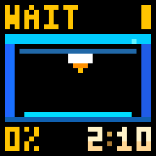 | **加热** 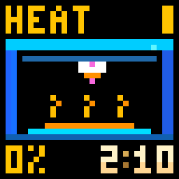 | **回零** 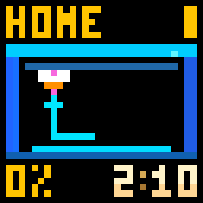 |
| **调平** 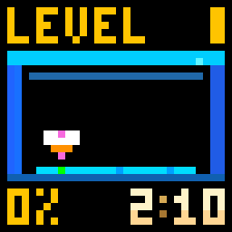 | **清洁喷嘴** 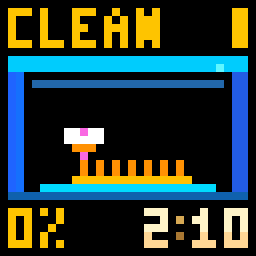 | **进退料** 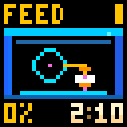 |
| **校准** 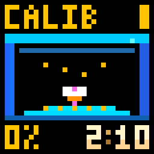 | **检查** 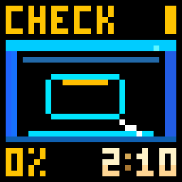 | **腔温加热** 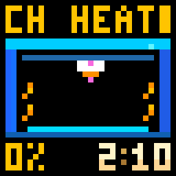 |

## 打印与耗材

|  |  |  |
|:---:|:---:|:---:|
| **首层打印** 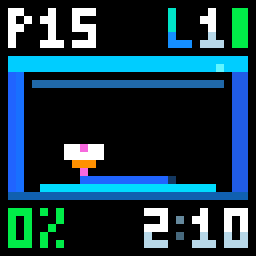 | **打印中换料** 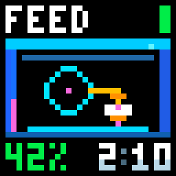 | **收尾等待** 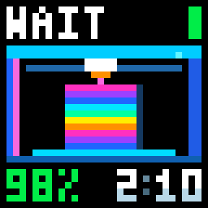 |
| **最后阶段** 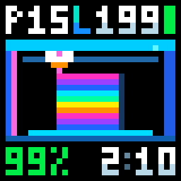 | **打印中腔温加热** 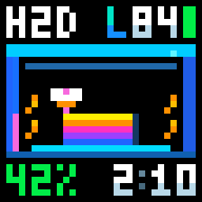 | **黑色耗材** 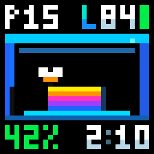 |
| **白色耗材** 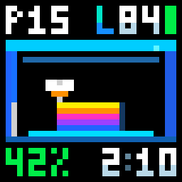 | **未知耗材颜色** 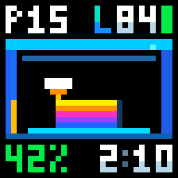 |  |

## 暂停与结果

|  |  |  |
|:---:|:---:|:---:|
| **暂停** 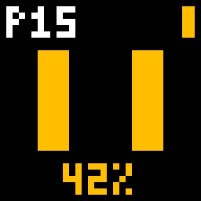 | **完成** 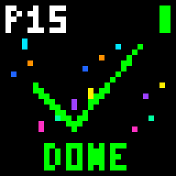 | **取消** 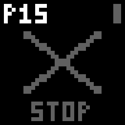 |
| **故障** 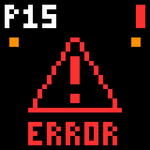 | **离线** 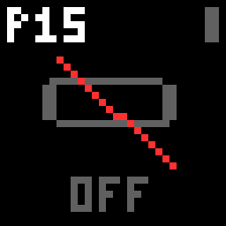 |  |

## 待机

|  |  |  |
|:---:|:---:|:---:|
| **待机时钟预览** 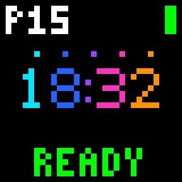 | **等待校时** 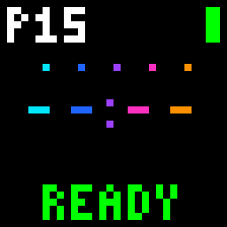 | **温湿度** 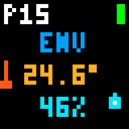 |

## 长参数滚动

|  |  |  |
|:---:|:---:|:---:|
| **长层数滚动** 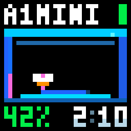 | **准备阶段长参数**  | **超长剩余时间** 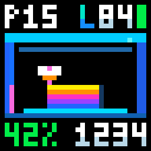 |

实际待机使用 iDotMatrix 内置时钟，字形以设备为准。勾选待机温湿度后，有有效环境读数时每 10 秒交替；无有效读数时保留时钟。

[返回项目首页](../README.md)
