# Screenshot gallery

[简体中文](SCREENSHOTS.md) | [English](SCREENSHOTS.en.md)

Demonstration renders; camera frames are illustrative. Board and printer capabilities determine availability.

## P4

| | |
|---|---|
| **Home** 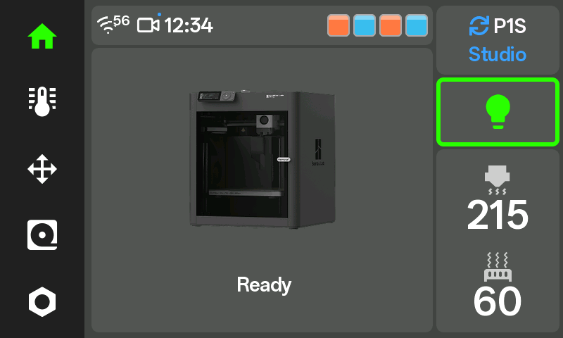 | **Printing** 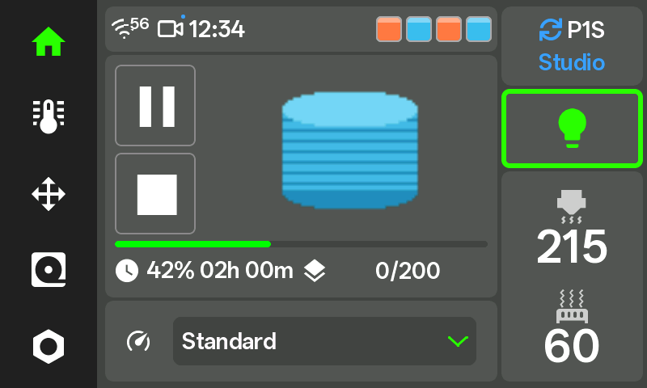 |
| **Printer selection** 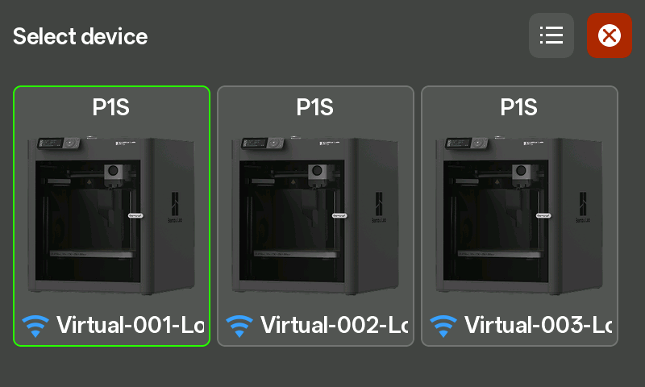 | **Temperature and fans** 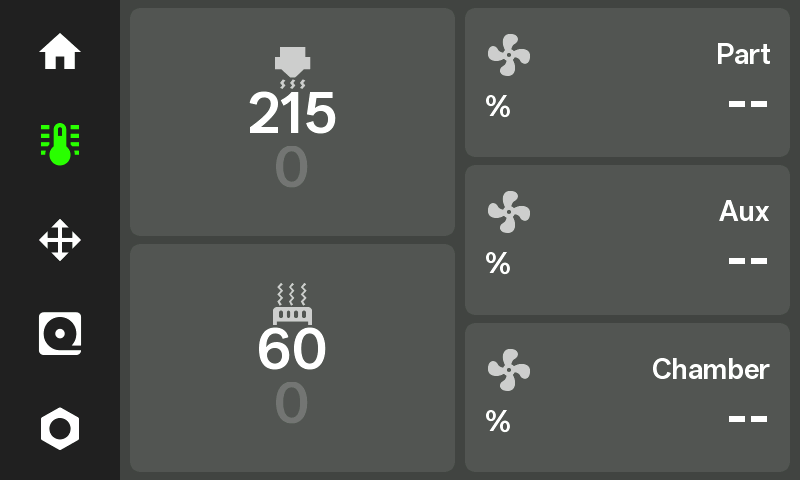 |
| **Filament** 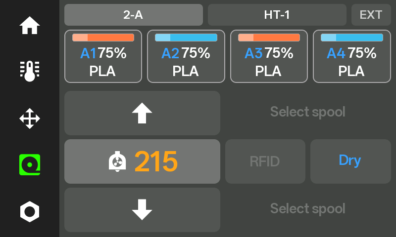 | **Camera** 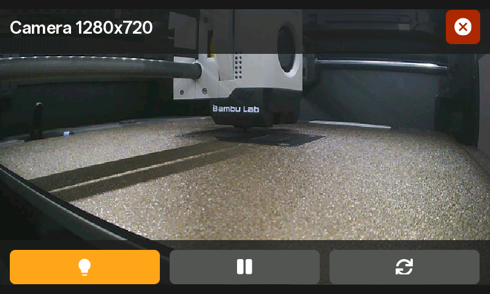 |
| **Movement** 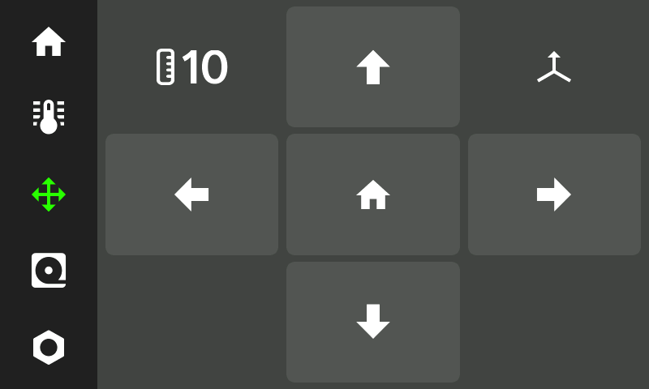 | **Settings** 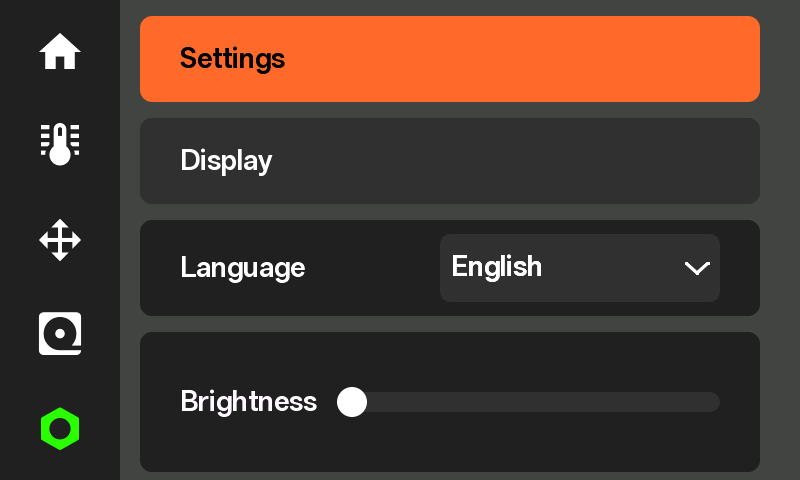 |
| **Thermometer** 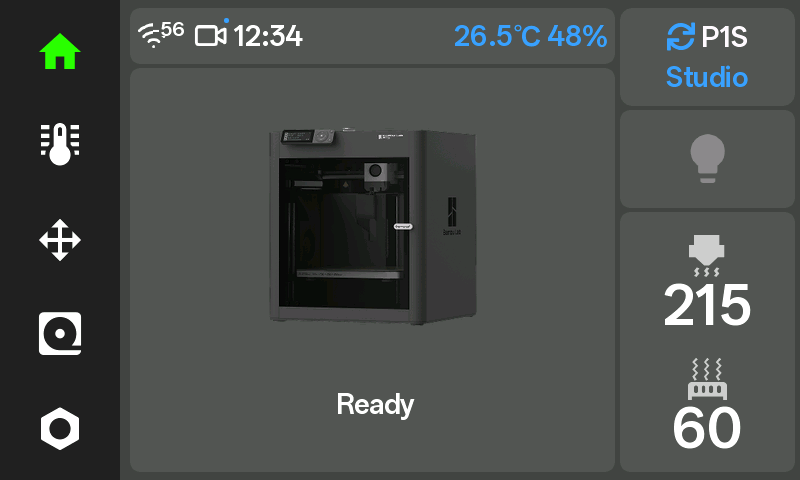 | **Wi-Fi setup**  |
| **Errors** 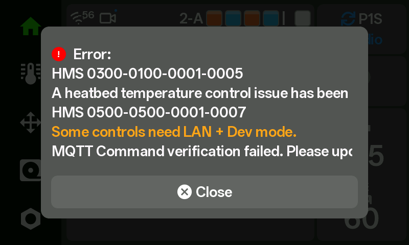 | **Printer list** 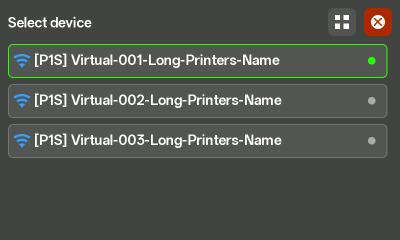 |

## S3

| | |
|---|---|
| **Home** 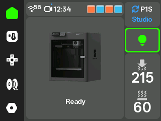 | **Printing** 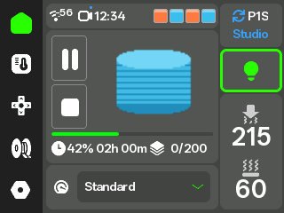 |
| **Printer selection** 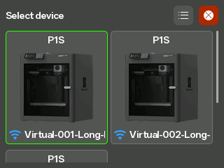 | **Temperature and fans**  |
| **Filament** 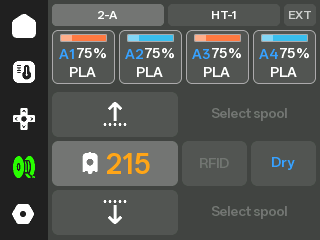 | **Camera** 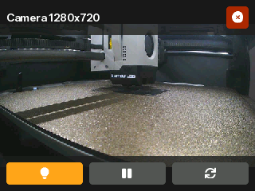 |
| **Movement** 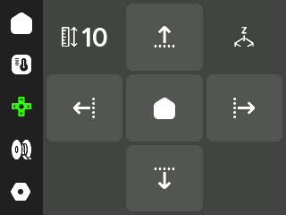 | **Settings**  |
| **Thermometer** 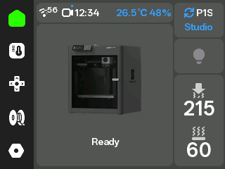 | **Wi-Fi setup**  |
| **Errors** 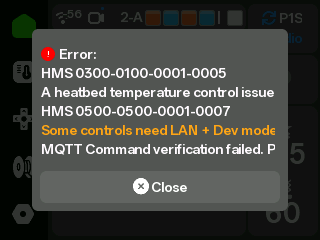 | **Printer list** 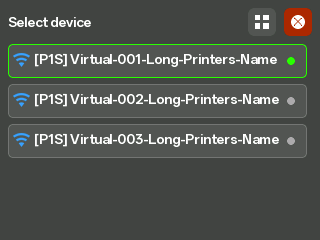 |

## CYD

| | |
|---|---|
| **Home** 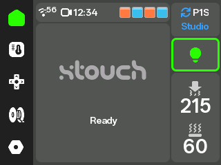 | **Printing** 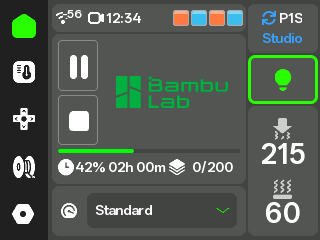 |
| **Temperature and fans** 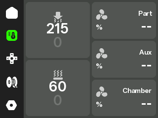 | **Filament**  |
| **Printer selection (list)** 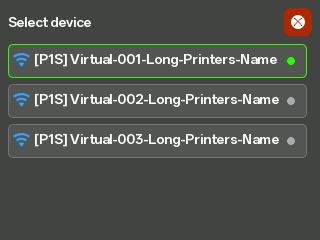 | **Movement**  |
| **Settings** 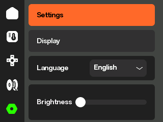 | **Thermometer** 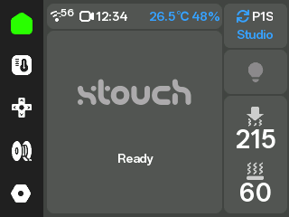 |
| **Wi-Fi setup**  | **Errors** 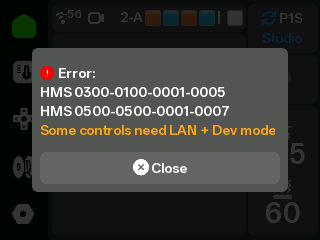 |

## ES3C35P 3.5-inch

| | |
|---|---|
| **Home** 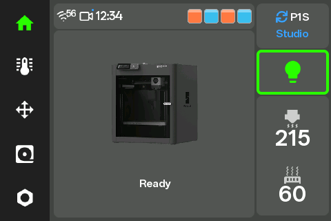 | **Printing** 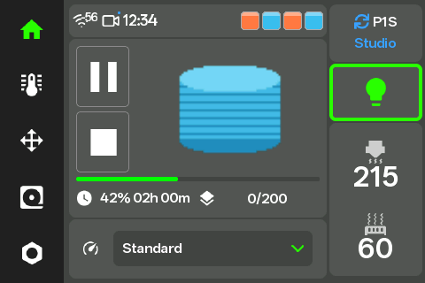 |
| **Printer selection**  | **Temperature and fans** 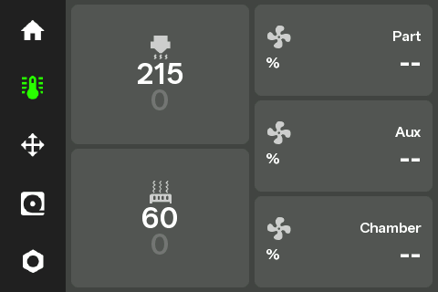 |
| **Filament** 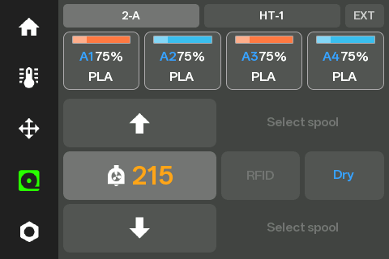 | **Camera** 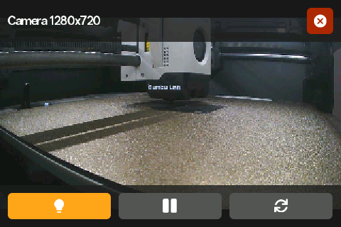 |
| **Movement** 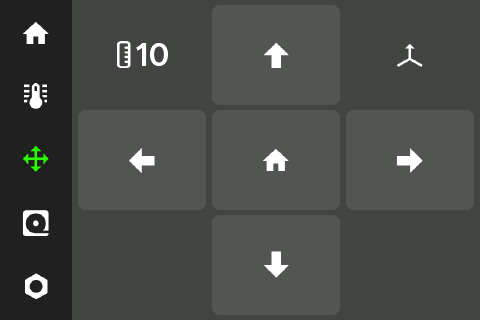 | **Settings** 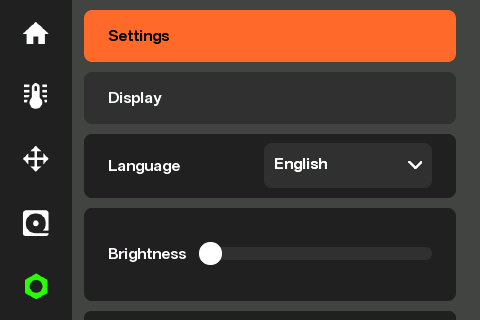 |
| **Thermometer** 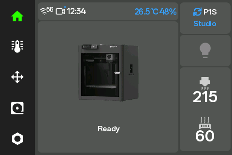 | **Wi-Fi setup**  |
| **Errors** 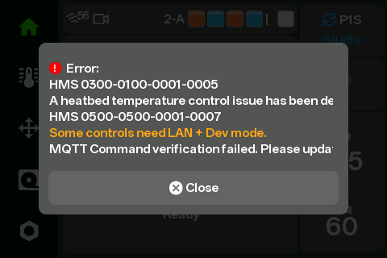 | **Printer list** 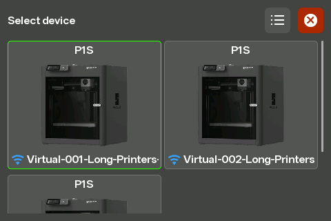 |
