# 界面图集

[简体中文](SCREENSHOTS.md) | [English](SCREENSHOTS.en.md)

使用演示数据渲染；摄像头画面仅作示意。具体支持范围以主板与打印机文档为准。

## P4

| | |
|---|---|
| **首页** 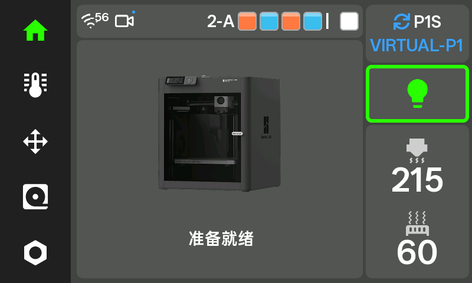 | **打印状态** 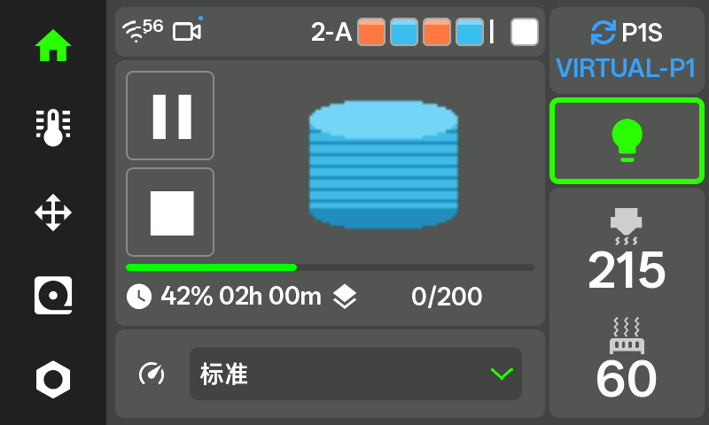 |
| **选择打印机** 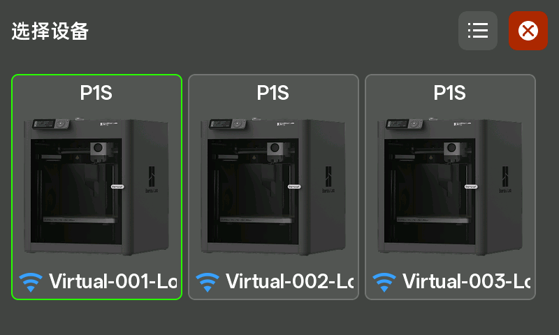 | **温度与风扇** 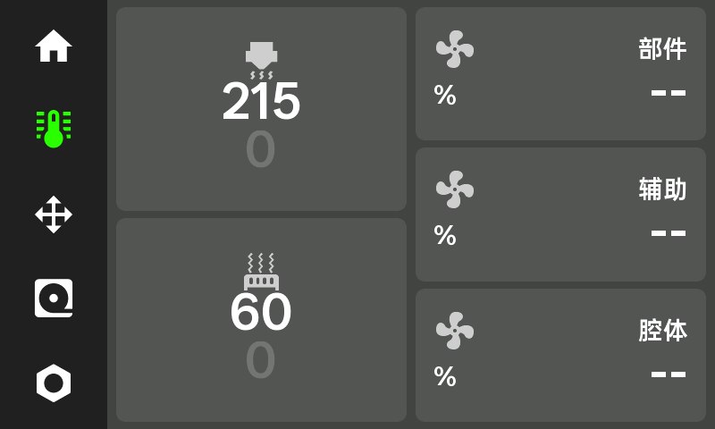 |
| **耗材** 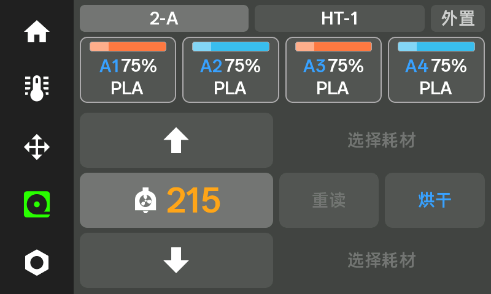 | **摄像头** 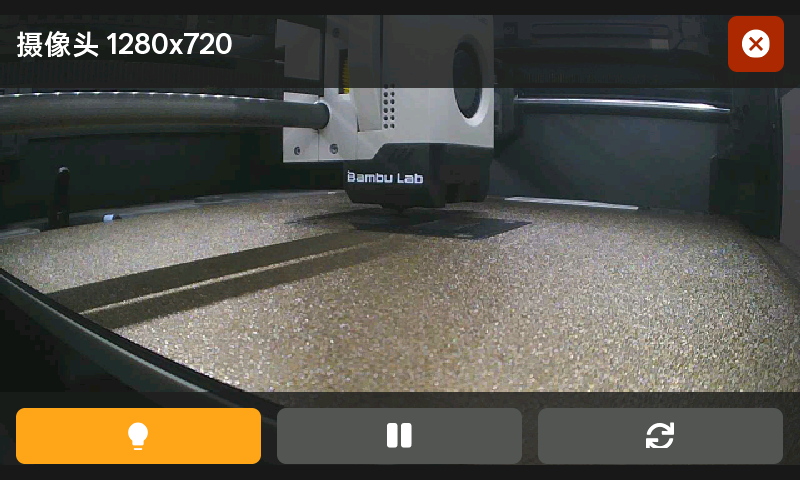 |
| **运动控制**  | **设置** 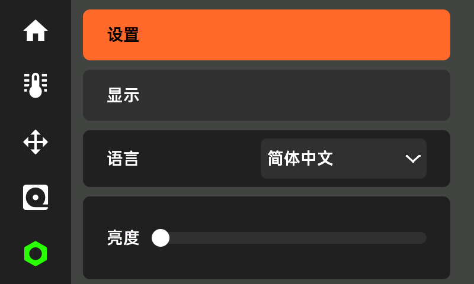 |
| **温湿度计** 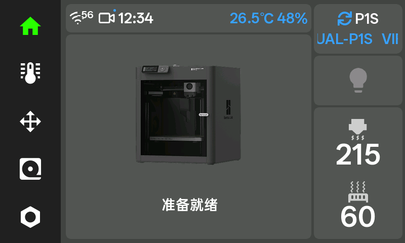 | **Wi-Fi配网**  |
| **故障提示** 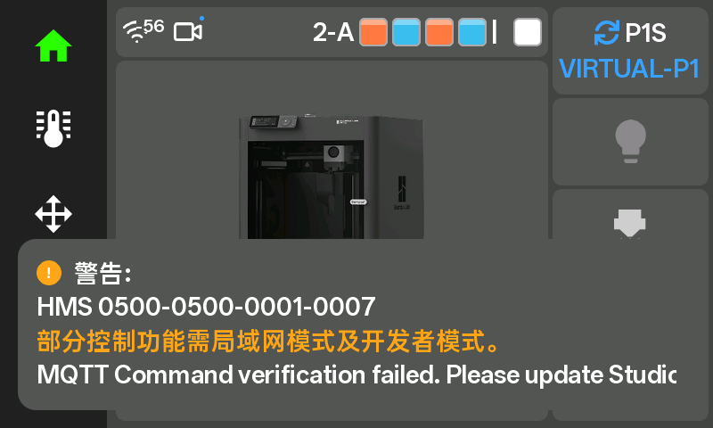 | **设备列表** 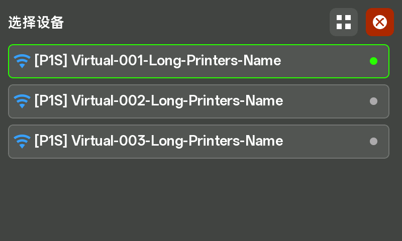 |

## S3

| | |
|---|---|
| **首页** 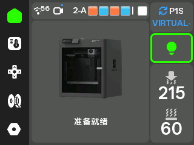 | **打印状态** 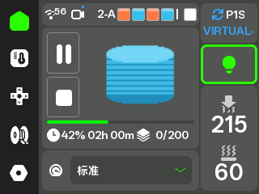 |
| **选择打印机** 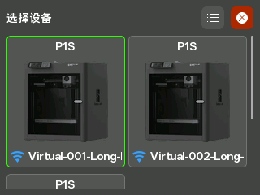 | **温度与风扇** 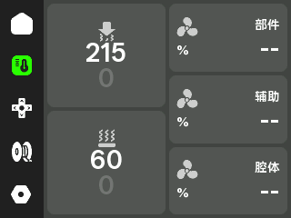 |
| **耗材**  | **摄像头** 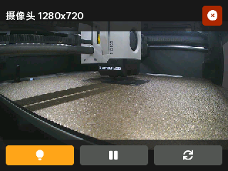 |
| **运动控制** 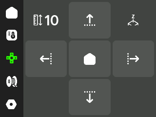 | **设置** 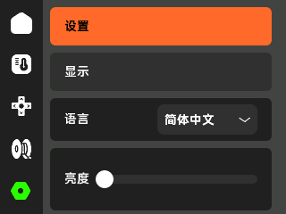 |
| **温湿度计** 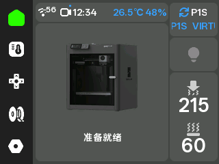 | **Wi-Fi配网**  |
| **故障提示** 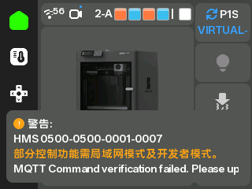 | **设备列表** 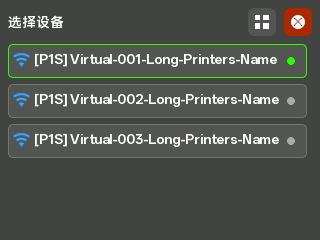 |

## CYD

| | |
|---|---|
| **首页** 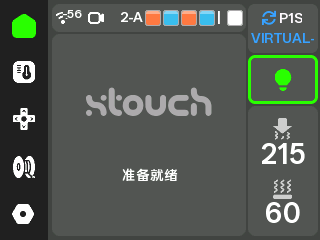 | **打印状态** 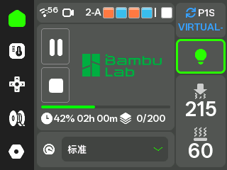 |
| **温度与风扇**  | **耗材** 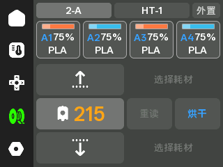 |
| **选择打印机（列表）** 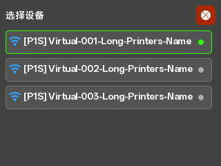 | **运动控制**  |
| **设置**  | **温湿度计** 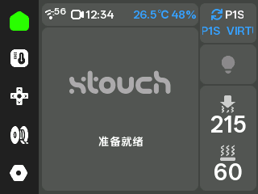 |
| **Wi-Fi配网**  | **故障提示** 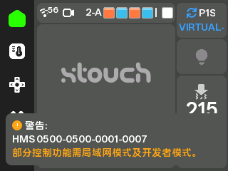 |

## ES3C35P 3.5寸

| | |
|---|---|
| **首页** 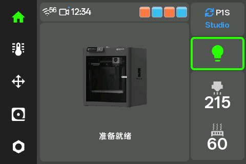 | **打印状态** 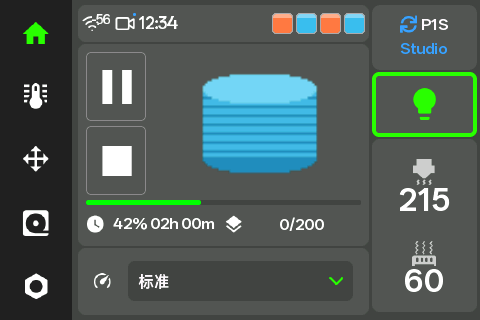 |
| **选择打印机** 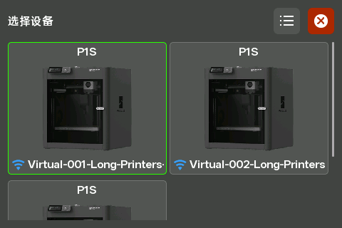 | **温度与风扇** 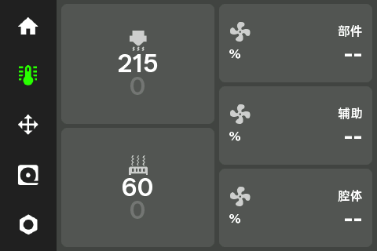 |
| **耗材** 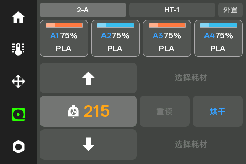 | **摄像头** 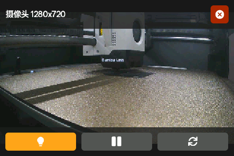 |
| **运动控制**  | **设置** 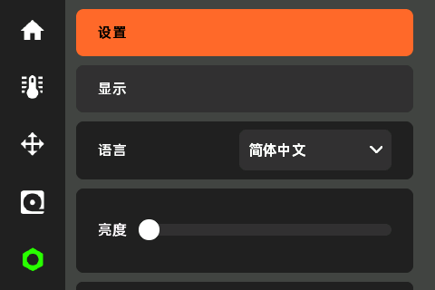 |
| **温湿度计** 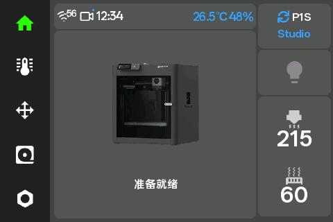 | **Wi-Fi 配网**  |
| **故障提示** 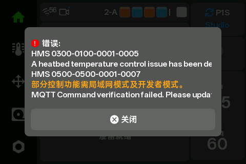 | **设备列表**  |
